# The Intent Runtime

## Browser Architecture and Frontend Engineering as Reference Models for AI Harness Design

**Type:** Technical thesis (computer science / AI software engineering), derived from a design thought experiment
**Audience:** Senior frontend engineers and architects. AI terms are explained; the DOM, the cascade, dependency injection and service workers are not.
**Status:** Conceptual architecture and prototyping direction. Statements about products, standards and tooling describe public discussion as of November 2026 and will age.
**Classification:** Internal
**Date:** November 2026

---

## Abstract

Current AI harnesses collapse several concerns into one object: the language model is treated as agent, scheduler, state store and user interface at once, and the chat transcript doubles as the system of record. This thesis argues that the next useful abstraction for applied AI is not a larger model but an _intelligence runtime_: a persistent, event-driven, capability-oriented execution environment in which models are interchangeable compute resources and the user's goal is a first-class, inspectable runtime object.

The argument proceeds by reference architecture. The web platform already solves most of the infrastructure problems such a runtime faces, and frontend engineering has mature answers for composition, state, declarative configuration, dependency injection, packaging and observability. We map both onto the harness problem, strictly separated into **build time** and **run time**, and we rate every mapping on a maturity scale and for research potential.

The weak point of such an argument is the headline analogy itself. The DOM works because it has a source language with a specified parser, because it is kept apart from everything derived from it, and because it lives under a security model built on origins. The Intent Object Model (IOM) therefore gets all three: a specified parsing step with recovery rules and user-confirmed intent diffs; a `spec`/`status` split with a derivation pipeline and invalidation classes; and an origin model with counterparts to CORS, CSP, Trusted Types and user activation. Around the IOM we place a family of object models, most importantly a constraint model resolved by a cascade, the CSSOM of this architecture.

---

## Contents

**Part I: Position.** 1 Introduction · 2 Foundations and Terminology · 3 Related Work
**Part II: Reference Architectures.** 4 The Browser as Reference Architecture · 5 The Object Model Family
**Part III: The Runtime Core.** 6 Architecture of the Intent Runtime · 7 The Intent Object Model · 8 The Constraint Model
**Part IV: Build Time.** 9 Build Time
**Part V: Run Time.** 10 Context and Memory · 11 Orchestration · 12 Security · 13 Composition at Scale: SSR, Federation, Micro Frontends · 14 Observability
**Part VI: Evaluation.** 15 Prototype Strategy · 16 Maturity and Research Register · 17 Discussion · 18 Conclusion
Appendix A Glossary · References

---

# Part I: Position

## 1. Introduction

### 1.1 From model size to runtime design

The thought experiment began with simulated fruit-fly brains. Such a simulation is a computational model of neural circuitry derived from connectome data, not a biological brain copied into software. Its relevance is systemic: a small, narrowly specialised system is useful when it sits inside an environment that gives it inputs, routes its outputs and combines it with other specialised systems. Useful behaviour emerges from composition.

Transferred to AI engineering, the design question shifts from "how large must the model be?" to "what runtime makes many computational capabilities work together?" A coding agent might use a small local model for trivial edits, a larger local model for harder ones, a frontier model for the hardest and an independent verifier for anything critical. The agent stays the same; the compute underneath changes.

### 1.2 Problem statement

- **P1. Model/agent conflation.** The model is addressed as agent, planner and scheduler. Lifecycle, permissions and state have no home.
- **P2. Transcript as state.** The chat history is the only persistent representation. It is linear, lossy and unqueryable.
- **P3. Context dumping.** Context is assembled by appending what fits. The context window becomes the database.
- **P4. Retrieval at the centre.** Vector retrieval is treated as the architecture rather than as one provider.
- **P5. Opaque execution.** No inspectable record of which model received which context and why.
- **P6. Unbounded autonomy loops.** The model decides what happens next, including resource allocation and authorisation.
- **P7. Unparsed intent.** What the user wants is never represented, confirmed or testable.
- **P8. Origin-less context.** The user's words, a tool result and a hostile web page share one context window with equal standing. It is a browser with no same-origin policy.
- **P9. Run time without build time.** Harnesses have behaviour but no resolution, checking, bundling or release discipline.

### 1.3 Thesis statement

> An intelligence runtime is to intent what the browser is to documents: a persistent execution environment that manages state, context, computation, capabilities, concurrency, storage, security and lifecycle around a first-class representation of the user's goal.

Four corollaries:

1. The model is not the agent and not the runtime; it is a compute resource.
2. Probabilistic components propose; deterministic components validate, authorise, execute and record.
3. The missing platform primitive is a shared, inspectable object model of the active intent, the IOM, with a family of object models around it.
4. The runtime owns _control_ (authority, audit, isolation, cost). It does not own _cognition_. Scaffolding that tells a model how to think is optional and must be removable (2.4).

### 1.4 Method, scope and a declaration of bias

This is a design thesis. Its method is architecture by analogy: take two mature reference systems, extract their structural solutions, test each against the runtime's requirements, adopt what holds and name the new primitive where it breaks. The claim is never that frontend has solved AI.

The thesis takes sides, and says so, because an analogy drawn from "frontend in general" would be mush.

- **Standards over libraries.** The DOM, the cascade, custom elements, Shadow DOM, service workers, IndexedDB and CORS will outlive every framework. We draw on the platform first.
- **Angular and web components over React.** Angular treats dependency injection, compilation and migrations as framework responsibilities, and it has stayed close to the platform. Web components _are_ the platform. React appears only where it is genuinely first (3.5).
- **Three languages, three files.** A `.tsx` file mixes structure, style and behaviour in one syntax. A prompt in a string literal inside application code is the same mistake. We keep intent, constraints and behaviour in separate, separately toolable artefacts (9.2).
- **Statecharts over reducers.** A reducer says how state changes; a statechart says which changes are legal. Agents need the second. Statecharts also have a formal semantics and a W3C Recommendation (SCXML) behind them. We use XState vocabulary throughout.

These are tastes, defended as engineering choices. Readers with other tastes can translate; the structure survives.

### 1.5 Contributions

- **C1.** The IOM as DOM-analogue with a specified parsing step, a `spec`/`status` split, versioned concurrency and typed epistemic state (Chapter 7).
- **C2.** A family of object models, including a constraint model resolved by a cascade (Chapters 5 and 8).
- **C3.** A layered runtime with a deterministic/probabilistic boundary and a control-plane/cognitive-plane split (Chapters 2, 6, 11).
- **C4.** A browser-to-runtime mapping with difference analysis (Chapter 4).
- **C5.** A frontend-to-harness mapping split into build time and run time: ESLint-style context composition, cache-aware bundling and critical-context extraction at build time; memory topology, hierarchical DI and update lifecycles at run time (Chapters 9 to 11).
- **C6.** An origin-based security model for agent context (Chapter 12).
- **C7.** Counterparts for SSR, module federation and micro frontends (Chapter 13).
- **C8.** A maturity and research register of 48 concepts (Chapter 16), and a phased prototype strategy (Chapter 15).

### 1.6 How to read this document

Everything in Part IV happens before an intent exists. Everything in Part V happens while one is live. Each major section opens with a line such as _Maturity M1 · research potential high_, using the scale of 2.5. All diagrams are Mermaid.

---

## 2. Foundations and Terminology

### 2.1 State, memory, knowledge, events, context

| Term          | Meaning                                                      | Mutability  | Canonical?                 |
| ------------- | ------------------------------------------------------------ | ----------- | -------------------------- |
| **Event log** | What happened, in what order, caused by which command        | Append-only | Yes (source of truth)      |
| **State**     | What is true now; a projection over events                   | Derived     | Yes (projected truth)      |
| **Memory**    | What was experienced or learned earlier                      | Curated     | No                         |
| **Knowledge** | Information that exists externally and can be retrieved      | External    | No                         |
| **Context**   | The subset of all of the above assembled for one computation | Ephemeral   | No (a view)                |
| **Evidence**  | What supports a particular claim or decision                 | Append-only | Yes, with epistemic status |

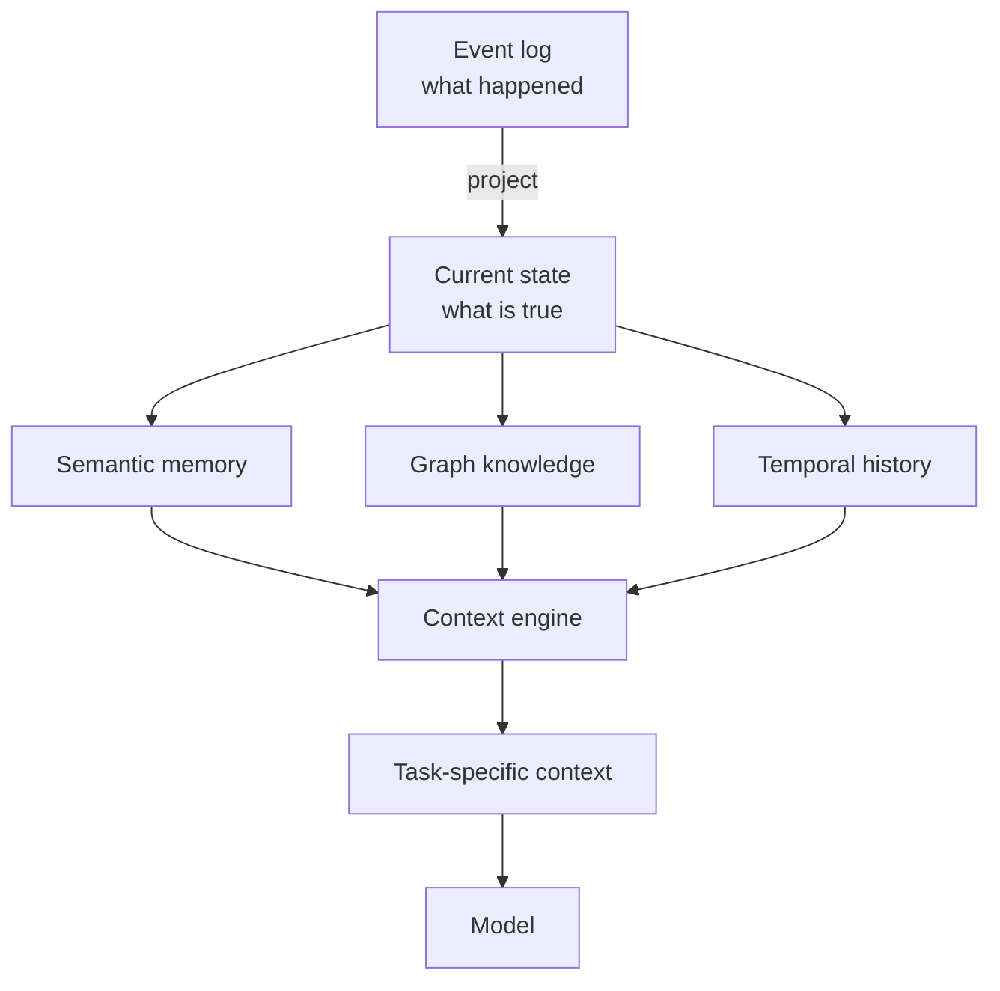

Retrieval-augmented generation is therefore a context provider, not the centre of the architecture. For software engineering tasks, relationship-aware structures (dependency graphs, symbol graphs, Git history, decision records, event history) usually beat similarity search over chunks.

### 2.2 Agent versus model

```text
Agent = role + state machine + capabilities + context policy
      + resource policy + permissions + lifecycle + event participation
Model = capability profile + invoke(request) -> result
```

An agent survives model substitution in _identity_. It survives in _behaviour_ only to the degree a conformance suite says so (9.5).

### 2.3 The deterministic/probabilistic boundary

| Probabilistic side (models, agents) | Deterministic side (runtime)                      |
| ----------------------------------- | ------------------------------------------------- |
| Natural-language interpretation     | Authorisation and permission checks               |
| Planning, hypothesis generation     | State transitions, event recording                |
| Classification, inference           | Schema and version validation                     |
| Decision and action _proposals_     | Capability execution                              |
|                                     | Budgets, policy enforcement, artifact persistence |
|                                     | Origin tagging, taint tracking, activation checks |

A model may propose `create_subgoal("Find flights")`. Only the runtime decides whether the proposal is valid, authorised, fresh and within budget, and only the runtime records it.

It is tempting to say the boundary is crossed in one direction only. That is true for authority and false for data. Results flow back into the model through context, and that return path is where prompt injection lives. The runtime guards it with an origin gate.

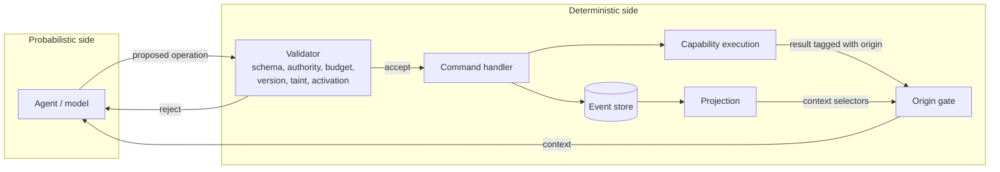

### 2.4 Control plane and cognitive plane

Harness components encode beliefs about what models do badly, and models keep improving. Practitioners now report that models absorb harness behaviour and that components should be switched off one at a time on each model release to see which still earn their place [Absorb]. A thesis that prescribes a thinking procedure will be obsolete on a schedule it does not control.

| Plane               | Contains                                                             | Depends on model strength? | Policy                                                                       |
| ------------------- | -------------------------------------------------------------------- | -------------------------- | ---------------------------------------------------------------------------- |
| **Control plane**   | Authority, origins, audit, isolation, budgets, lifecycle, versioning | No                         | Mandatory                                                                    |
| **Cognitive plane** | Planning procedure, decomposition, self-critique, memory heuristics  | Yes                        | Optional; each component ships with eval evidence and an ablation test (9.9) |

Every mechanism in this thesis is assigned to one plane. If a future model makes a cognitive-plane component useless, deleting it must not touch the control plane.

### 2.5 Maturity model and research potential

The maturity scale rates the _AI counterpart as a general engineering abstraction_, not any product.

| Level  | Label                   | Interpretation                                                       |
| ------ | ----------------------- | -------------------------------------------------------------------- |
| **M0** | Missing                 | No established general-purpose counterpart                           |
| **M1** | Experimental            | Prototypes, research or bespoke implementations                      |
| **M2** | Emerging                | Useful implementations exist; patterns and interfaces are fragmented |
| **M3** | Established, incomplete | Widely used solutions; standardisation or reliability gaps remain    |
| **M4** | Mature                  | Stable abstractions and broadly understood practice                  |

A maturity level alone says little when most concepts land on the same rating. We therefore add a second axis.

| Research potential | Meaning                                                      |
| ------------------ | ------------------------------------------------------------ |
| **Low**            | The remaining work is adoption and engineering               |
| **Medium**         | The design space is open but known techniques apply          |
| **High**           | An open problem with no accepted solution and large leverage |

These are qualitative judgements.

### 2.6 Reference disciplines

- **CQRS and event sourcing** supply command/event/projection discipline and durable history.
- **Statecharts** (Harel; SCXML; XState) supply explicit lifecycles with recovery paths.
- **The twelve-factor methodology** supplies the operations layer.
- **The web platform** supplies object models, origins, storage tiers, workers and lifecycles.
- **Frontend engineering** supplies declarative configuration, DI, packaging, bundling, testing and observability.
- **Kubernetes** supplies the `spec`/`status` split and reconciliation.

---

## 3. Related Work

Each table says what the work covers and what it leaves open _for this thesis_.

### 3.1 Protocols and standards

| Work                                          | Covers                                                                                                                                                     | Leaves open                                                    |
| --------------------------------------------- | ---------------------------------------------------------------------------------------------------------------------------------------------------------- | -------------------------------------------------------------- |
| MCP [MCP]                                     | Tool, resource and prompt interface between host and server; tool annotations (read-only, destructive, idempotent); stewarded by the Agentic AI Foundation | Shared state, scheduling, origins                              |
| MCP Apps [AgentUI]                            | UI as a server-provided resource in a sandboxed iframe                                                                                                     | Shared intent state between app and agent                      |
| A2A [A2A]                                     | Discovery through agent cards, delegation and task exchange between opaque agents; v1.0                                                                    | What agents share: there is no common object model             |
| AGENTS.md, Agent Skills, Agent Plugins [AAIF] | Repository instructions; packaged procedural knowledge with progressive disclosure; bundles of skills and MCP servers                                      | Resolution semantics, peer model dependencies, published evals |
| AG-UI, A2UI [AgentUI]                         | A typed event stream between agent backend and frontend (1.0 with 31 event types); declarative generative UI                                               | Events describe a run, not an intent; no durable projection    |
| WebMCP [WebMCP]                               | Pages register tools for in-browser agents, with origin gating and Permissions Policy for frames; Chrome origin trial                                      | What happens to data after the tool returns                    |
| NLWeb, llms.txt                               | Natural-language endpoints; machine-readable site summaries                                                                                                | Actions and authority                                          |
| AP2 and Verifiable Intent [AP2]               | Signed Intent, Cart and Payment Mandates binding user instructions to agent purchases                                                                      | Payments only; the pattern generalises (7.3, 12.8)             |
| OpenTelemetry GenAI conventions               | Span vocabulary for model and tool calls                                                                                                                   | Intent-level semantics                                         |

### 3.2 Harnesses, frameworks and durable execution

| Work                                             | Covers                                                                                                | Leaves open                                                  |
| ------------------------------------------------ | ----------------------------------------------------------------------------------------------------- | ------------------------------------------------------------ |
| Claude Agent SDK, Codex, Gemini CLI, goose       | Production single-loop harnesses: context management, permissions, sandboxing, sub-agents, compaction | State is a transcript plus files; thin build-time discipline |
| LangGraph, Microsoft Agent Framework, Google ADK | Graph orchestration, checkpoints, time travel, interrupts                                             | Checkpoints are framework-private                            |
| Temporal, Restate, DBOS, Inngest                 | Durable, replayable workflows that require deterministic orchestration code                           | The agent step is not deterministic (9.9)                    |
| 12-Factor Agents [12FA]                          | Principles: own your prompts and context window, unify execution and business state, pause and resume | Principles, not a runtime                                    |
| Manus context engineering [Manus]                | Cache-stable prefixes, append-only context, masking instead of removing tools                         | Applied by hand                                              |
| The harness-absorption debate [Absorb]           | Evidence that models absorb scaffolding                                                               | Which parts are durable (2.4)                                |

### 3.3 Operating-system and browser analogies

| Work                                                                                               | Covers                                                    | Leaves open                                                                             |
| -------------------------------------------------------------------------------------------------- | --------------------------------------------------------- | --------------------------------------------------------------------------------------- |
| "LLM OS", MemGPT/Letta [MemGPT], AIOS                                                              | Model as CPU, context as RAM with paging, an agent kernel | An OS has processes and files but no document. Nothing plays the DOM's role             |
| Agentic browsers (ChatGPT Atlas, Comet, Gemini in Chrome, Edge Copilot Mode, Neon, Dia, BrowserOS) | Agents operating pages for the user                       | Mostly browser plus chatbot; same-origin regressions are documented [UW-SOP] [SOPGuard] |
| Chrome built-in AI, WebNN, WebLLM                                                                  | Models as browser-provided compute                        | The runtime around them                                                                 |

### 3.4 Context and prompts as engineered artefacts

| Work                            | Covers                                                                                   | Leaves open                                    |
| ------------------------------- | ---------------------------------------------------------------------------------------- | ---------------------------------------------- |
| Priompt [Priompt]               | Prompts as components with priorities; context window as screen size; prompt source maps | Its README warns about cacheability; it is JSX |
| DSPy, BAML, TypeChat            | Prompts as compiled programs; typed outputs                                              | Per call; no runtime state                     |
| Spec-driven development tooling | A reviewed spec file before generation                                                   | The spec is a document, not a live object      |

### 3.5 Security

| Work                                         | Covers                                                                                                   | Leaves open                                            |
| -------------------------------------------- | -------------------------------------------------------------------------------------------------------- | ------------------------------------------------------ |
| Dual LLM (Willison), CaMeL [CaMeL], FIDES    | Privileged planning separated from quarantined reading; provenance and capabilities tracked on values    | A policy vocabulary. The browser has one (Chapter 12)  |
| Instruction hierarchy; ManyIH [ManyIH]       | Privilege levels among instructions, resolved inside the model; frontier models struggle with many tiers | Deterministic resolution outside the model (Chapter 8) |
| SOP for agentic browsers [UW-SOP] [SOPGuard] | Measurement of violations; an enforcement mechanism                                                      | An origin model for runtimes in general                |
| Step-up authentication, CIBA [StepUp]        | Out-of-band human approval                                                                               | Still a prompt; no causal gating (12.8)                |
| React taint API [Taint]                      | Marking objects that must not cross the server/client boundary                                           | Derived values are not protected (12.6)                |
| ToxicSkills, OWASP lists [Lock]              | Measured supply-chain attacks on skills                                                                  | n/a                                                    |

### 3.6 Packaging

| Work                                                                           | Covers                                                                    | Leaves open                                                                          |
| ------------------------------------------------------------------------------ | ------------------------------------------------------------------------- | ------------------------------------------------------------------------------------ |
| MCP Registry, ToolHive, APM, Quiver, skill-lock, NVIDIA verified skills [Lock] | Lockfiles with content hashes, provenance, signing, scanning, SBOM export | Incompatible formats; no shared resolution, peer model dependencies or eval evidence |

Registries and lockfiles are often described as "largely missing". The accurate statement is: present, plural and incompatible.

### 3.7 Earlier uses of "intent" as an object

| Work                                              | Covers                                                                                                   | Leaves open                                             |
| ------------------------------------------------- | -------------------------------------------------------------------------------------------------------- | ------------------------------------------------------- |
| Android Intents, Apple App Intents                | A typed action message; the OS resolves implicit intents against declared filters                        | One action; no goal structure or lifecycle              |
| W3C Web Intents (abandoned), Schema.org Actions   | Web-level action discovery                                                                               | Died for lack of publisher incentive: a warning for 4.6 |
| Intent-based networking (RFC 9315)                | A declared outcome, continuously assured                                                                 | A closed domain with formal state                       |
| Kubernetes                                        | Desired state reconciled against observed state                                                          | Deterministic controllers                               |
| Intention Abstraction Layer [IAL]                 | Intentions as shared runtime objects that are registered, monitored and retired across industrial agents | The closest in spirit; no platform mapping              |
| BDI agents, goal models (KAOS, i\*), HTN planning | Formal goal decomposition and deliberation                                                               | Design-time or single-agent                             |

### 3.8 Classic foundations and cautionary precedents

Blackboard systems (Hearsay-II), the actor model, statecharts, CQRS and event sourcing, truth-maintenance systems, incremental build systems, and LSP, DAP and the Chrome DevTools Protocol as precedents for small protocols that decoupled whole ecosystems. On the cautionary side: WSDL, UDDI and OWL-S described a capability-oriented web twenty years ago and nobody came. COM and the Office object models turned applications into platforms and into malware vectors in the same move.

### 3.9 What remains new here

To our knowledge nobody has combined: an intent object model with a specified parse step and a `spec`/`status` split; a cascade for constraints resolved outside the model; invalidation classes for re-planning; origin-based context security expressed in the browser's own mechanisms; and a build/run separation with bundling, critical-context extraction and update lifecycles. Individual pieces have prior art, cited where used.

---

# Part II: Reference Architectures

## 4. The Browser as Reference Architecture

### 4.1 Why the analogy is structural

A browser coordinates heterogeneous computation, persistent and ephemeral state, networking, caching, background execution, security, extensions, resource management, process isolation, lifecycle and debugging. Each is a requirement of an intelligence runtime. The analogy is a list of solved problems.

### 4.2 Primitive mapping and differences

| Browser primitive                                    | Intelligence runtime                                         |
| ---------------------------------------------------- | ------------------------------------------------------------ |
| Browser                                              | Intelligence runtime                                         |
| Tab                                                  | Intent workspace / session                                   |
| Page                                                 | Session view                                                 |
| HTML and its parser                                  | Utterance and the intent parser (7.3)                        |
| DOM                                                  | IOM                                                          |
| CSSOM and the cascade                                | Constraint model (Chapter 8)                                 |
| Accessibility tree                                   | Capability tree (4.6) and oversight tree (5.3)               |
| JavaScript                                           | Agent and model computation                                  |
| V8                                                   | LLM / inference engine                                       |
| Web APIs                                             | Capability APIs                                              |
| Web Worker                                           | Agent worker bound to a session                              |
| Service Worker                                       | Background, event-driven agent that outlives the view        |
| Event loop                                           | Intelligence scheduler                                       |
| Storage tiers                                        | Memory topology (10.2)                                       |
| History                                              | Event and decision history                                   |
| Extensions                                           | Skills and plugins                                           |
| Origin and same-origin policy                        | Context origins (Chapter 12)                                 |
| Permissions                                          | Capability security                                          |
| Processes (browser, renderer, GPU, utility, network) | Orchestrator, agent, model, verification and tool workers    |
| Profile                                              | Personal intelligence environment                            |
| DevTools and its protocol                            | Intelligence DevTools (Chapter 14)                           |
| URL                                                  | Resource identifier; intents get addressable identifiers too |

| Browser                                          | Intelligence runtime                                    |
| ------------------------------------------------ | ------------------------------------------------------- |
| Mostly deterministic                             | Probabilistic                                           |
| Page is the primary unit                         | Intent is the primary unit                              |
| URL identifies a resource                        | Intent identifies an outcome                            |
| HTTP is the core interface                       | Capability negotiation may be the core interface        |
| State is comparatively objective                 | Knowledge carries uncertainty and provenance            |
| History is navigation                            | History includes decisions, evidence, actions, outcomes |
| Rendering is a repeatable function of its inputs | Execution changes the world                             |
| The scheduler is mechanical                      | The scheduler must sometimes reason about allocation    |

### 4.3 The LLM is V8, not the browser

V8 is powerful because it sits inside a runtime that supplies a DOM to act on, APIs to call, storage, a security model and tools to debug it. Remove the browser and V8 is a fast interpreter with nothing to do. The LLM is in the same position. V8 is also replaceable for a reason: ECMAScript has a specification and a conformance suite. Models have neither, which is why 9.5 asks for one.

### 4.4 Process architecture and workers

The runtime mirrors the browser's process separation: orchestrator, agent workers, retrieval workers, model workers, verification workers and tool workers, connected by an event bus rather than ad hoc IPC. A Web Worker corresponds to an agent worker spawned for a subgoal. A Service Worker corresponds to a monitoring agent that reacts to events when no session is open. The service worker's _update_ lifecycle is as valuable as its background nature (11.9). The alternative to one giant autonomous loop is explicit state transitions, isolated workers and durable events.

### 4.5 Tabs as intents, profiles as environments

A tab gives user-visible separation, a resource lifecycle, a context boundary, interruptibility and a mental model users already own. Mapping tab to _intent_, not to agent, preserves all of it: "Launch product", "Plan vacation" and "Debug production issue" are three tabs, each with its own agent graph, working memory, artifacts and event stream, sharing one profile.

The mapping needs two refinements. Intents are not always separable, so cross-intent communication uses explicit channels modelled on `postMessage` and `BroadcastChannel`, never shared mutable memory. And tabs under resource pressure follow the Page Lifecycle states (11.10).

### 4.6 The semantic capability layer and the capability-oriented web

_Maturity M2 · research potential medium (standards work)._

Agents should not operate the DOM when a semantic capability can be exposed. `SearchWeb`, `ReadPage`, `FillForm`, `SubmitForm`, `Authenticate`, `Purchase`, `Schedule` are the right granularity; click-and-type is a fallback for legacy sites.

Web 1 addressed documents, Web 2 applications; an AI-native web addresses capabilities. The flow user → URL → application → UI → action becomes user → intent → capability discovery → orchestration → outcome. UI does not disappear; it becomes a situational output modality. A service exposes:

```text
Capability:  SearchFlights
Inputs:      origin · destination · date · passengers
Constraints: max_price · preferred_airlines
Permissions: user_approval_required
SideEffects: none (safe, idempotent)
Outputs:     flight_options
Evidence:    source · timestamp
```

This layer is an **accessibility tree for agents**, and capability declarations are its ARIA. Three lessons transfer.

1. **Semantics must be authored.** Accessibility engineering learned that meaning cannot be reliably inferred from visuals.
2. **Incentives decide adoption.** WSDL, UDDI and Web Intents failed because publishers had no reason to care. ARIA succeeded with legal pressure, free semantics from native elements and tooling. WebMCP [WebMCP] has the first real incentive, a browser vendor shipping a consumer, but it is one engine in an origin trial.
3. **The bridge is community typings.** DefinitelyTyped carried JavaScript through its untyped decade with third-party declarations. Legacy sites will need the same: community-maintained capability declarations, versioned and attested.

### 4.7 What is reused and what must be invented

| Reused from the web platform                | Invented for intelligence                      |
| ------------------------------------------- | ---------------------------------------------- |
| Processes, workers, IPC                     | IOM, intent parser, intent events              |
| Networking, storage, caching                | Context engine and context bundler             |
| Origins, CORS, CSP, permissions, sandboxing | Taint for model steps; activation by causality |
| The cascade                                 | Constraint properties and their checks         |
| Extensions, tabs, profiles                  | Model router, capability negotiation           |
| DevTools                                    | Epistemic state, verification, provenance      |

Hence: AI browser = browser runtime + intelligence runtime, not browser + chatbot.

---

## 5. The Object Model Family

### 5.1 Which object models already exist

"Object model" is a naming tradition, not a single thing.

| Object model                               | Standing                        | Represents                                                                    | Lesson for the IOM                                                  |
| ------------------------------------------ | ------------------------------- | ----------------------------------------------------------------------------- | ------------------------------------------------------------------- |
| **DOM**                                    | WHATWG Living Standard          | Document structure as a mutable tree with events                              | Specified in WebIDL and tested by conformance suites                |
| **CSSOM**                                  | W3C                             | Style sheets, rules, computed values                                          | Constraints live apart from structure and resolve through a cascade |
| **CSS Typed OM**                           | W3C (Houdini)                   | CSS values as typed objects                                                   | The cure for `value: unknown` (8.2)                                 |
| **AOM / accessibility tree**               | WICG incubation; partly shipped | Roles, names, states for assistive technology                                 | A derived projection for non-visual consumers; see below            |
| **BOM** (`window`, `navigator`, `history`) | Informal name                   | The environment around the document                                           | The runtime needs an ambient environment object                     |
| **Shadow DOM**                             | Standard                        | Encapsulated subtrees with a declared surface                                 | Encapsulation with slots, parts and retargeted events (7.10)        |
| **SVG DOM, MathML**                        | Standard                        | Domain vocabularies in the same tree                                          | The IOM needs namespaced domain vocabularies                        |
| **Web Audio graph**                        | Standard                        | A dataflow graph of nodes, not a tree                                         | Precedent for a graph-shaped model with typed edges                 |
| **Layout, layer, fragment trees**          | Engine-internal                 | What the engine derives from DOM and CSSOM                                    | Derived trees are never script-mutable                              |
| **Virtual DOM**                            | Library convention              | A diffing workaround                                                          | Do not standardise workarounds                                      |
| **ESTree**                                 | De facto standard               | Code as a tree                                                                | A shared intermediate representation makes rules portable (9.3)     |
| **COM**                                    | Microsoft, 1993                 | Binary component interfaces; `QueryInterface` asks an object what it supports | Capability negotiation is thirty years old                          |
| **Office object models**                   | Vendor                          | Documents as scriptable objects                                               | A scriptable object model is also an attack surface                 |
| **Page Object Model**                      | Test pattern                    | A semantic façade over the DOM                                                | The capability layer is a page object for the web                   |
| **Kubernetes object model**                | CNCF                            | `spec` versus `status`, reconciled                                            | Adopted directly (7.4)                                              |

The AOM deserves its own paragraph. Reflecting ARIA attributes on elements shipped everywhere; events from assistive technology were abandoned; virtual accessibility nodes are blocked; querying the computed tree is partial [AOM]. Two lessons. An object model for machine consumers is only as good as what authors put into it. And exposing _who is consuming_ is a privacy leak: a site that can detect an assistive-technology user can detect an agent user.

### 5.2 Structure, constraints, behaviour

The web's most durable design decision is the separation of structure (HTML), presentation rules (CSS) and behaviour (JavaScript), each with its own language, object model and tools. The runtime adopts the same triad.

| Web       | Runtime                | Language / artefact           | Object model         |
| --------- | ---------------------- | ----------------------------- | -------------------- |
| Structure | What is wanted         | Utterance, confirmed spec     | **IOM**              |
| Rules     | Under which conditions | Constraint sheets             | **Constraint model** |
| Behaviour | Who does the work      | Agents (statecharts, prompts) | Agent graph          |

### 5.3 The IOM family

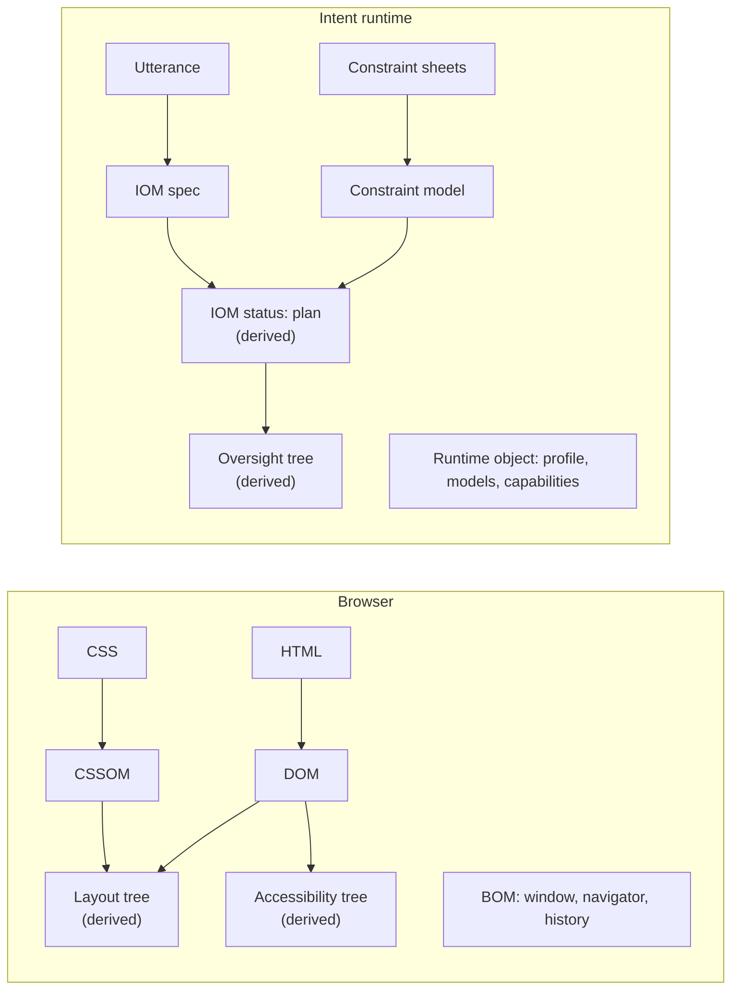

- **IOM `spec`**: goals, acceptance criteria, user-declared constraints. User-owned.
- **Constraint model**: every constraint declaration from every origin, and the resolved value per node.
- **IOM `status`**: plan, assignments, evidence, decisions, artifacts. System-owned, derived.
- **Oversight tree**: a stable projection giving every node a role, name, state and value for people, auditors and assistive technology. Chat renders from it. It is what human-oversight obligations need.
- **Capability tree**: the semantic view of what the outside world offers (4.6).
- **Runtime object**: `runtime.profile`, `runtime.models`, `runtime.capabilities`, `runtime.budget`, `runtime.history`.

### 5.4 Naming

"Intent Object Model" continues the tradition and avoids its collisions: COM, BOM and POM are taken. We therefore say "constraint model" and "oversight tree" rather than mint more three-letter acronyms.

---

# Part III: The Runtime Core

## 6. Architecture of the Intent Runtime

### 6.1 Design principles

- **DP1. Model as compute resource.** Comparable to V8 or a GPU kernel: indispensable, replaceable, not the platform.
- **DP2. Context is constructed, not dumped.** A policy-governed projection of canonical state, reproducible and inspectable.
- **DP3. Events are first-class.** Durable history is the source of truth; state is derived.
- **DP4. Memory is a topology.** One vector store does not fit all.
- **DP5. Generation and verification are separable.**
- **DP6. Capabilities are negotiated.** Agents request capabilities, not implementations.
- **DP7. Chat is a view.** One projection among several.
- **DP8. Intent is the primary object.**
- **DP9. Spec is owned by the user, status by the system.**
- **DP10. Every piece of context has an origin.**
- **DP11. Stable things first.** Context is laid out by volatility because inference caches reward stable prefixes.
- **DP12. Control is mandatory, cognition is optional.**

### 6.2 Layer model

| Layer                         | Question answered                                 | Main components                                                    |
| ----------------------------- | ------------------------------------------------- | ------------------------------------------------------------------ |
| 1. Intent                     | What does the user want, under which constraints? | Intent workspace, parser, IOM, constraint model                    |
| 2. Runtime                    | How is work coordinated and secured?              | Scheduler, lifecycle, event store, context engine, security kernel |
| 3. Capabilities               | What can the system do?                           | Capability registry, skills, semantic capability layer             |
| 4. Models                     | What computes inference?                          | Model router, local and cloud model runtimes                       |
| 5. State / memory / knowledge | What does the system know, remember, observe?     | Event log, projections, memory tiers, knowledge providers          |

Layer 5 supports all the others.

### 6.3 Core runtime loop

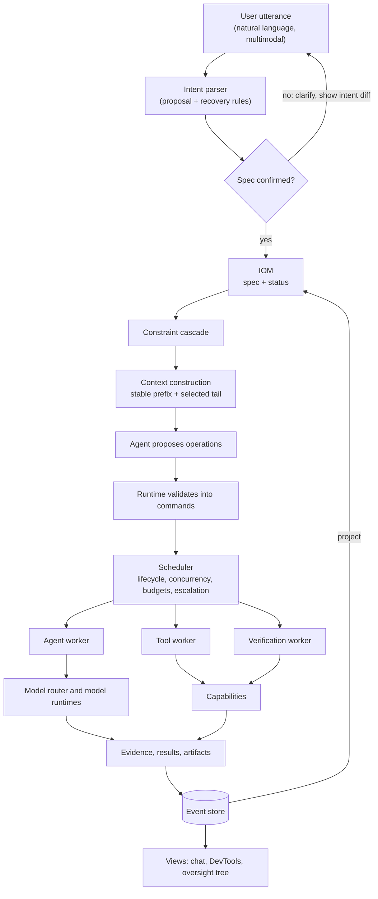

### 6.4 Runtime objects

| Object            | Contains                                                                                                                  | Browser analogue |
| ----------------- | ------------------------------------------------------------------------------------------------------------------------- | ---------------- |
| **Profile**       | Identity, preferences, permissions, long-term memory, installed skills, model pool and policies, knowledge, event history | Browser profile  |
| **Session (tab)** | One intent, its IOM, agent graph, working context and memory, artifacts, event stream, view                               | Tab + page       |
| **Agent**         | Identity, role, state machine, capability requirements, context and resource policy, permissions                          | Worker           |
| **Worker**        | Isolated unit of concurrent execution hosting an agent, tool or model call                                                | Process / worker |
| **Capability**    | Identity, schemas, permissions, side effects, risk level, approval requirements, audit events, implementation             | Web API          |
| **Skill**         | Versioned package of capabilities, context providers and presets                                                          | Extension        |
| **Origin**        | Identity of whoever contributed a piece of context or a value                                                             | Origin           |

A tab is an intent workspace, not an agent.

### 6.5 Conceptual architecture

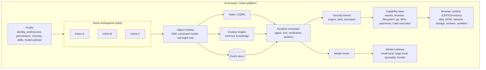

---

## 7. The Intent Object Model

_Maturity M1 · research potential high._

### 7.1 Motivation: the missing centre

Before the IOM, the architecture had agents, models, tools, state, memory, events, a scheduler and a browser, and every subsystem talked to every other. The IOM replaces that mesh with a hub. The context engine reads from it, agents propose changes to it, the scheduler reacts to it, DevTools inspect it and chat renders it.

### 7.2 Definition and comparison with the DOM

> The IOM is the runtime's shared, inspectable object graph representing an active intent: what is wanted (`spec`) and what the system has derived and done about it (`status`).

| DOM                                                  | IOM                                                                  |
| ---------------------------------------------------- | -------------------------------------------------------------------- |
| HTML is parsed into the DOM by a specified algorithm | An utterance is parsed into `spec` by a specified procedure (7.3)    |
| Represents document structure                        | Represents intent and work structure                                 |
| Nodes                                                | Goals, acceptance criteria, subgoals, evidence, decisions, artifacts |
| Attributes                                           | Metadata; constraints live in the constraint model                   |
| DOM events                                           | Intent events                                                        |
| Scripts mutate the DOM                               | Agents _propose_ operations; the runtime commits                     |
| Layout and paint are derived                         | `status` is derived (7.9)                                            |
| DevTools inspect the DOM                             | Intent DevTools inspect the IOM                                      |
| Accessibility APIs consume a derived tree            | Oversight tools consume the oversight tree                           |
| Extensions observe and manipulate                    | Skills observe and propose                                           |

### 7.3 Parsing: from utterance to intent

_Maturity M1 · research potential high._

The HTML parser is the unsung reason the DOM works. It is specified down to its error recovery, so every engine builds the same tree from the same broken markup. Building the IOM by having a model guess, and validating only that the guess is well-formed, gives up exactly that property.

A model still proposes the draft. Everything around the proposal is specified.

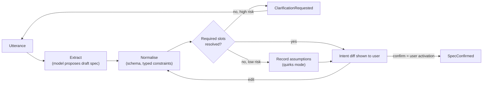

- **Required slots per intent type.** As elements have required attributes, an intent type (`purchase/*`, `coding/*`) declares slots that must be resolved.
- **Standards mode and quirks mode.** In standards mode an unresolved required slot blocks and raises `ClarificationRequested`. In quirks mode the parser fills the slot and records an `Assumption` node with origin `inferred`. The risk tier picks the mode.
- **Acceptance criteria are nodes.** Every goal carries at least one criterion of kind `test`, `schema`, `verifier` or `human`. `GoalCompleted` is emitted by the runtime when criteria pass, never by an agent's say-so.
- **The intent diff.** Before the first side-effecting command the runtime renders the parsed spec back to the user: what will count as done, which constraints apply, what was assumed. Confirmation is a user activation (12.8). AP2's chain from Intent Mandate to Cart Mandate is this pattern in one domain [AP2].
- **Parser tests at build time.** Paraphrasing an utterance must yield an equivalent spec; rendering a spec to text and parsing it again must round-trip (9.9).

Open: recovery rules can be specified; whether a model follows the user's meaning cannot. The diff moves that risk in front of the user instead of removing it.

### 7.4 Spec and status; graph, not tree

```text
intent.spec    written only by user-confirmed commands
intent.status  written only by the runtime, as a projection of events
```

This is Kubernetes' split, and it has the same consequence: the scheduler is a reconciliation loop driving `status` toward `spec`. If the user edits `spec`, nothing is patched by hand; the affected parts of `status` are invalidated and re-derived (7.9).

Dependencies cross branches, so `status.plan` is a directed graph with typed edges.

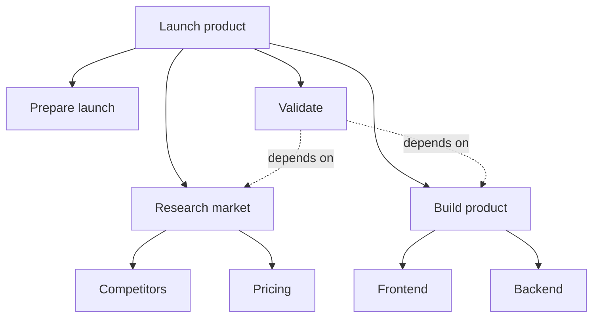

"Intent Object Graph" is the more precise term; "Intent Object Model" is kept because, like "DOM", it names the API.

### 7.5 Schema and operations

```ts
interface Intent {
  id: string;
  schema: 'iom/2.0';
  version: number;
  spec: IntentSpec; // user-owned
  status: IntentStatus; // system-owned, derived
}
interface IntentSpec {
  goals: Goal[];
  constraints: ConstraintDeclaration[]; // resolved by the cascade (Chapter 8)
  assumptions: Assumption[];
  confirmedBy?: ActivationRef;
}
interface Goal {
  id: string;
  description: string;
  acceptance: AcceptanceCriterion[];
  priority?: number;
}
interface AcceptanceCriterion {
  id: string;
  kind: 'test' | 'schema' | 'verifier' | 'human';
  check: CheckRef;
}
interface Assumption {
  id: string;
  slot: string;
  value: unknown;
  origin: Origin;
  confirmed: boolean;
}

interface IntentStatus {
  phase: IntentPhase;
  plan: Subgoal[];
  dependencies: Dependency[];
  agents: AgentRef[];
  evidence: EvidenceRef[];
  decisions: Decision[];
  artifacts: ArtifactRef[];
}
interface Subgoal {
  id: string;
  goal: string;
  status: TaskStatus;
  dependsOn: string[];
  assignedAgent?: string;
  version: number;
  contained?: boolean;
}
interface Evidence {
  id: string;
  origin: Origin;
  contentRef: Hash;
  observedAt: string;
  verifiedAt?: string;
  status: EpistemicStatus;
  independence?: Independence;
}
type EpistemicStatus = 'observed' | 'inferred' | 'verified' | 'stale' | 'contradicted';
interface Decision {
  id: string;
  proposal: string;
  rationale?: string;
  dependsOn: string[];
  status: 'proposed' | 'accepted' | 'rejected' | 'invalidated';
}
interface ArtifactRef {
  id: string;
  type: string;
  location: string;
  producedBy: string;
  taint: Origin[];
}
interface Origin {
  kind: 'user' | 'profile' | 'runtime' | 'skill' | 'tool' | 'web';
  id: string;
}

interface Command {
  op: string;
  target: string;
  readVersion: number;
  causation: EventId[];
  activation?: ActivationRef;
}
```

Agents never mutate the graph. They invoke operations, which the runtime validates into commands:

```text
intent.parse()             intent.attachEvidence()
intent.confirmSpec()       intent.proposeDecision()
intent.addConstraint()     intent.acceptDecision()
intent.createSubgoal()     intent.createArtifact()
intent.assignAgent()       intent.requestVerification()
intent.requestCapability() intent.block() · intent.escalate() · intent.complete()
```

### 7.6 The IOM as a projection: CQRS and event sourcing

_Maturity M2–M3 · research potential medium._

The IOM is a projection over an event stream: proposal → validator → command handler → event → append-only store → projection → IOM → consumers (diagram in 2.3).

**Event taxonomy.**

```text
Intent:        IntentParsed · SpecConfirmed · ClarificationRequested · AssumptionRecorded
               IntentPaused · IntentResumed · IntentEscalated · IntentCompleted · IntentFailed
Goal:          GoalAdded · GoalUpdated · GoalCompleted
Constraint:    ConstraintAdded · ConstraintUpdated · ConstraintViolated
Subgoal:       SubgoalCreated · SubgoalUpdated · SubgoalBlocked · SubgoalCompleted
Agent:         AgentAssigned · AgentStarted · AgentPaused · AgentResumed · AgentStopped · AgentFailed
Capability:    CapabilityRequested · CapabilityGranted · CapabilityDenied · CapabilityExecuted
Context:       ContextRequested · ContextBuilt · ContextExpanded · ContextInvalidated
Model:         ModelSelected · ModelInvoked · ModelCompleted · ModelFailed · ModelEscalated
Evidence:      EvidenceProduced · EvidenceAttached · EvidenceVerified · EvidenceContradicted
Decision:      DecisionProposed · DecisionAccepted · DecisionRejected · DecisionInvalidated
Artifact:      ArtifactCreated · ArtifactUpdated · ArtifactVerified
Verification:  VerificationRequested · VerificationPassed · VerificationFailed
Concurrency:   CommandRejectedStale · ForkCreated · ForkCommitted · ForkDiscarded
Security:      ActivationGranted · ActivationConsumed · TaintDeclassified · PolicyViolationReported
```

**Time travel.** Projecting events `1..N` yields the IOM at time _T_: why the agent decided this, what it knew, which model and context were used, what triggered escalation.

**Invocation snapshots.** Every model call records model and version, policy, agent state, intent and context snapshot, tool outputs, resource policy and timestamp. Reproducibility of _inputs_ is achievable and is the precondition for analysis. Snapshots are stored by content hash, so a context chunk used by a thousand calls is stored once.

**Schema evolution.** The model is IndexedDB's: a store has a version, and an upgrade handler migrates old data. Events are immutable; registered _upcasters_ translate old event versions on read.

### 7.7 Concurrency: versions, transactions, forks

_Maturity M1 · research potential high._

Concurrency control does not come for free. A model call takes seconds to minutes, so every proposal is computed against an old snapshot. The platform already has the tools.

| Platform mechanism                     | Runtime use                                                                                                              |
| -------------------------------------- | ------------------------------------------------------------------------------------------------------------------------ |
| `ETag` / `If-Match`                    | Every node has a `version`; every command carries `readVersion`. A stale command is rejected with `CommandRejectedStale` |
| IndexedDB transactions                 | A command batch names its scope and mode, commits atomically, aborts as a whole                                          |
| Web Locks API (`shared` / `exclusive`) | Named locks on IOM subtrees across agents and tabs                                                                       |
| `DocumentFragment`                     | Agents plan in a **fork** and attach it atomically, or the fork is discarded                                             |
| `AbortController`                      | In-flight work carries a signal; when its inputs are invalidated the runtime aborts it                                   |
| Navigation API                         | A newer user instruction supersedes the pending one instead of queueing behind it                                        |

Semantic conflict has a definition: the validator evaluates the resolved constraints against the _would-be_ state, not against each command alone. Two individually valid commands that jointly break a constraint fail at commit. Reads within one scheduler tick see one snapshot.

### 7.8 Epistemic state, provenance and retraction

_Maturity M1 · research potential high._

Browser state is comparatively objective. An intelligence runtime deals in beliefs. A bare `confidence` number has no semantics. The IOM therefore stores a status with an evidence chain, as a discriminated union. A numeric score is admissible only with a reference to how it was calibrated.

Every artifact carries a provenance graph:

```text
Artifact
├── produced_by  -> agent
├── model        -> model version
├── context      -> context snapshot (hash)
├── based_on     -> evidence
├── origins      -> every origin that influenced it (taint)
├── verified_by  -> verifier, with independence record
└── caused_by    -> events
```

**Retraction.** A decision is a _computed value_ over evidence, in the sense of Angular's `computed()`: its dependencies are tracked. When evidence turns `stale` or `contradicted`, its dependents are marked dirty, `DecisionInvalidated` is emitted and the scheduler re-verifies or reopens them. This is truth maintenance implemented as a reactive graph.

### 7.9 The derivation pipeline and invalidation classes

_Maturity M0–M1 · research potential high._

A browser turns DOM and CSSOM into pixels through style, layout, paint and composite, and it knows for every change the earliest stage that must rerun. That knowledge is why animating `transform` is cheap and changing `width` is not. The runtime gets the same pipeline.

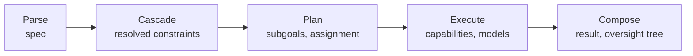

| Change                              | Earliest stage dirtied                   | Browser analogue         |
| ----------------------------------- | ---------------------------------------- | ------------------------ |
| Goal or acceptance criterion edited | Parse                                    | DOM mutation             |
| Hard constraint added or tightened  | Cascade, then plan for matching subgoals | Geometry-changing style  |
| Evidence contradicted               | Verification of dependents only          | Paint-only invalidation  |
| Priority or deadline changed        | Scheduling only                          | Compositor-only property |
| New evidence attached               | Nothing, unless a decision depends on it | Off-screen change        |

Three practices come along. **Batching:** an agent that alternates IOM writes with reads forces a re-plan per read, which is layout thrashing. Operations are batched per tick, in the read and write phases Angular's `afterRender` hooks formalise. **Containment:** a subgoal marked `contained` promises that its internals cannot affect siblings, as CSS `contain` does. **Honest cost:** the table is the answer to "the IOM is bureaucracy", because it makes cost proportional to the change.

### 7.10 Coordination and encapsulation

Point-to-point messaging between agents is hard to inspect and impossible to replay. The IOM replaces it with shared state: a blackboard architecture in which every write is a validated command and every read is scoped by the context engine. It yields inspectability, decoupling, replayability and auditability. Concurrency control is earned in 7.7.

Not every agent step belongs on the blackboard. Web components supply the vocabulary.

|                 | **Light agent**              | **Shadow agent**                                                    |
| --------------- | ---------------------------- | ------------------------------------------------------------------- |
| Analogue        | Light DOM                    | Shadow DOM                                                          |
| Granularity     | Every step is an IOM command | Runs its own loop in a sandbox under a fixed grant                  |
| Visible outside | Everything                   | Declared parts, composed events, the result with an evidence bundle |
| Inputs          | IOM slices                   | Attributes and slotted content only                                 |
| Inspectability  | Full                         | `open` (DevTools can look inside) or `closed`                       |
| Use for         | High-risk, multi-party work  | Bounded cognitive work: exploring a codebase, drafting, searching   |

Rules: inherited constraints pierce the shadow boundary and non-inherited ones do not, as CSS inheritance behaves (8.3). Events crossing it are retargeted to the host subgoal. Regulated deployments should require `open`. A shadow agent is where the cognitive plane lives: inside it the model may think however it likes.

### 7.11 Standardisation

If the IOM proves useful it could become a platform interface as the DOM did. The incentives look doubtful at first sight, but two things change the picture: a neutral venue now hosts MCP, A2A, AGENTS.md and Agent Skills under one roof [AAIF], and the web's own history suggests a better route than a specification.

- **Write the interface in an IDL.** Every web object model is specified in WebIDL, and conformance tests are generated from it.
- **Start as a test suite.** Web Platform Tests and the Interop effort converged engines more effectively than prose ever did.
- **Keep it small.** Nodes, operations, events, origins. Domain vocabularies are namespaced extensions.

---

## 8. The Constraint Model: A Cascade for Policy

_Maturity M1 · research potential high._

### 8.1 Why "nearest wins" is not enough

ESLint resolves configuration by a simple rule: later and nearer overrides earlier. That is right for build configuration. It is wrong for policy, where several parties with different authority make claims about the same node: the platform, the enterprise, a skill author, the user. Today's harnesses ask the model to arbitrate. Research on instruction hierarchies shows that models do this unreliably once there are more than a few tiers [ManyIH]. The cascade was designed for this situation and is deterministic. It runs in the runtime; the model sees only the result.

### 8.2 Constraint sheets and registered properties

Constraints are declared in sheets, in their own file type, with selectors over the IOM.

```css
/* enterprise.constraints: user-agent origin */
@layer platform, skills, project;

intent {
  privacy: trusted-cloud;
  budget: 2 EUR;
}
subgoal[risk='high'] {
  verification: required !important;
}
capability[side-effect='money'] {
  approval: user-activation !important;
}

@layer skills {
  agent.researcher subgoal {
    model-tier: small;
    freshness: 1h;
  }
}

@container intent (budget < 0.20 EUR) {
  subgoal {
    model-tier: small;
    parallelism: 1;
  }
}
```

Every property is registered, as CSS `@property` registers a custom property, with a syntax, an inheritance flag, an initial value and a _check_ that decides violation. This replaces `Constraint { type: string; value: unknown }`.

```css
@property budget {
  syntax: '<money>';
  inherits: true;
  initial-value: 0 EUR;
  check: 'runtime/budget';
}
@property privacy {
  syntax: '<privacy-tier>';
  inherits: true;
  initial-value: local-only;
  check: 'runtime/egress';
}
@property approval {
  syntax: '<approval>';
  inherits: false;
  initial-value: none;
  check: 'runtime/activation';
}
```

Values are typed objects, in the spirit of the CSS Typed OM.

### 8.3 The resolution algorithm

| Cascade concept                   | Constraint model                                                                                                           |
| --------------------------------- | -------------------------------------------------------------------------------------------------------------------------- |
| **Origins**                       | _User-agent_: platform and enterprise policy. _Author_: skill and agent packages. _User_: the person                       |
| **Normal precedence**             | user-agent < user < author: a skill's specific instruction beats a general user preference, which beats a platform default |
| **`!important` reverses origins** | author < user < user-agent: a user's hard constraint beats any skill's insistence; a platform hard limit beats everything  |
| **Cascade layers**                | Skill defaults sit in a low layer, so a host can always override them                                                      |
| **Specificity**                   | Scope precision: task beats agent beats session                                                                            |
| **Inheritance**                   | Per property: `privacy` and `budget` inherit down the subgoal graph; `approval` does not                                   |
| **`revert`**                      | Roll back to what the previous origin said                                                                                 |
| **Custom properties**             | Policy tokens (`--max-retries`) shared across sheets                                                                       |
| **Container queries**             | Conditions on the resource envelope: budget, connectivity, context-window size                                             |
| **Computed value**                | The effective constraint per node, recorded with the winning declaration                                                   |

The importance reversal gives two things from one mechanism. The origin that supplies the weakest defaults also supplies the strongest limits. Enterprise policy can be a gentle default sheet and a set of non-negotiable rules at once, with no special cases in code.

### 8.4 Encapsulation and adoption

Shadow agents (7.10) follow the platform's rules. Inherited properties and tokens cross the boundary. A sub-intent can _adopt_ shared sheets as shadow roots adopt constructable style sheets. Whatever a shadow agent exposes for outside control is a declared part.

### 8.5 Relation to DI attenuation

The cascade decides _which value applies_. Attenuation (11.3) decides _who may bind what_. A rule both systems share: along the scope tree, hard limits only tighten.

---

# Part IV: Build Time

## 9. Build Time

### 9.1 Why frontend engineering, and why two phases

Part of the motivation was the worry that code generation makes frontend engineering obsolete. The conclusion is more specific: code generation moves the discipline's value upward, from producing UI code to designing composable runtime abstractions. Frontend engineers think in two phases, and the AI side is weakest in the first.

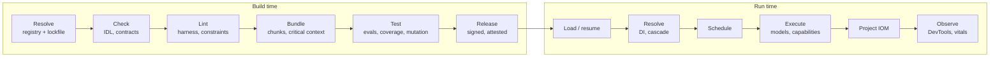

| Frontend build                       | Harness build                            | AI maturity |
| ------------------------------------ | ---------------------------------------- | ----------- |
| `package.json`, registry, lockfile   | Agent manifest, skill registry, lockfile | M2          |
| Type check (`tsc`, strict templates) | IDL, capability and fragment contracts   | M1–M2       |
| Lint (ESLint)                        | Harness and constraint lint              | M1–M2       |
| AOT compile                          | Compiled context plans                   | M1          |
| Bundle, tree-shake, split, budgets   | Context chunks, pruning, budgets         | M2          |
| Critical CSS inlining                | Critical-context extraction              | M1–M2       |
| Tests, snapshots, e2e                | Evals, semantic snapshots, replay        | M2–M3       |
| Prerender (SSG)                      | Prerendered intents                      | M1          |
| `ng update` migrations               | Model and skill migrations               | M1          |
| Signed artefact                      | Versioned, signed agent release          | M2          |

### 9.2 Three languages, three files

A harness that keeps its prompt in a template literal, its policy in an `if` statement and its lifecycle in a `while` loop has one untoolable file. We prescribe separate artefacts:

```text
agent.manifest.yaml     dependencies, peer model capabilities (15.5)
context.config.js       declarative context composition (9.3)
*.constraints           constraint sheets (8.2)
agent.machine.ts        lifecycle statechart (11.1)
prompts/*.md            prompt templates, one per file, versioned
```

Each has its own linter and diff, as Angular keeps template, styles and class apart.

### 9.3 Declarative context composition: ESLint as reference architecture

_Maturity M2 · research potential medium to high._

ESLint's flat configuration is a reference architecture for declarative, composable, overridable, plugin-extended analysis pipelines. Its structure transfers almost one-to-one to context composition.

**ESLint, reduced to its parts.** A config file exports an array of objects. Each may declare `files`, `languageOptions` (parser, ambient `globals`), `plugins` (namespaced packages contributing rules and presets), `rules` (identifier → severity and options), `processors` and `settings`. Later objects override earlier ones for matching files. Presets are ordinary objects spread into the array. A rule is a module with `meta` (including a JSON Schema for its options) and a `create(context)` function returning a visitor over AST node types, optionally using esquery selectors. Rules _report_, may _fix_ or _suggest_. Different parsers produce ESTree-compatible trees, so rules are parser-independent. `--print-config` shows the resolved configuration for one file.

| ESLint                                  | Context composition                                                                                         |
| --------------------------------------- | ----------------------------------------------------------------------------------------------------------- |
| Config array with override              | Layered context config: profile → project → session → task                                                  |
| `files` globs                           | Task matchers: task type, intent domain, agent role, risk tier                                              |
| `languageOptions.parser`                | Fragment schema version (`iom/2.0`); all providers emit schema-compatible fragments                         |
| `languageOptions.globals`               | Ambient context always present: identity, date, active policies                                             |
| `plugins` (namespaced)                  | Provider and skill packages (`@context/repository`)                                                         |
| `rules` with `off`/`warn`/`error`       | Fragment rules with `off`/`optional`/`required`; a required provider that cannot deliver fails construction |
| Rule options validated by JSON Schema   | Provider options validated at build time                                                                    |
| `processors`                            | Transformers: chunking, summarisation, redaction, de-duplication                                            |
| `settings`                              | Shared provider settings                                                                                    |
| Presets (`recommended`)                 | Archetype presets (`@context-config/coding/recommended`)                                                    |
| `create(context)` with injected context | `resolve(query)` with an injected runtime handle; providers never reach into global state                   |
| esquery selectors                       | IOM selectors: "subgoals blocked on evidence older than one hour"                                           |
| `report` / `fix` / `suggest`            | Emit `ContextViolation` / auto-adjust (lower resolution, drop optional) / propose a decision                |
| Formatters (stylish, JSON, SARIF)       | Prompt renderers per model family; same snapshot, different serialisation                                   |
| `--print-config`                        | `runtime context explain <task>`: the Context Inspector                                                     |
| Inline disable directives               | Per-task exceptions, recorded as events                                                                     |

The two configurations below are structurally the same program.

```js
// eslint.config.js
import js from '@eslint/js';
import tseslint from 'typescript-eslint';
import importPlugin from 'eslint-plugin-import';

export default [
  js.configs.recommended,
  ...tseslint.configs.recommended,
  {
    files: ['src/**/*.ts'],
    plugins: { import: importPlugin },
    languageOptions: { parser: tseslint.parser, globals: { window: 'readonly' } },
    rules: {
      'import/no-cycle': 'error',
      '@typescript-eslint/no-explicit-any': ['warn', { fixToUnknown: true }],
    },
  },
  { files: ['**/*.test.ts'], rules: { '@typescript-eslint/no-explicit-any': 'off' } },
];
```

```js
// context.config.js
import coding from '@context-config/coding';
import repo from '@context/repository';
import git from '@context/git';

export default [
  ...coding.configs.recommended,
  {
    tasks: ['coding/*'],
    providers: { repo, git },
    schema: 'iom/2.0',
    ambient: { identity: 'always', activeProject: 'always' },
    fragments: {
      'repo/conventions': ['required', { chunk: 'project', critical: true }],
      'memory/decisions': ['required', { chunk: 'intent' }],
      'repo/relevant-files': ['required', { chunk: 'step', maxFiles: 20, ranking: 'symbol-graph' }],
      'git/recent-commits': [
        'optional',
        { chunk: 'step', limit: 10, resolutions: ['full', 'summary', 'handle'] },
      ],
    },
    processors: ['@context/processors/redact-personal-data', '@context/processors/summarise-long'],
    budget: { maxTokens: 32000, warnAt: 24000, onOverflow: 'lower-resolution' },
  },
  {
    tasks: ['coding/hotfix'],
    fragments: { 'git/recent-commits': ['required', { limit: 30 }] },
    budget: { maxTokens: 64000 },
  },
];
```

The new keys are `chunk` (9.6), `critical` (9.7) and `resolutions` (10.6).

**Pipeline correspondence.** ESLint: sources → parser → AST → rules → messages → formatter. Context engine: sources → providers → IOM-shaped fragments → selectors and rules → snapshot → renderer. ESLint's rules are portable because every parser produces ESTree. Context rules become portable when every provider produces the same fragment schema.

**Least privilege.** An agent declares typed inputs as an Angular component declares `input()`s. The engine binds exactly those slices. What an agent did not declare, it cannot read.

### 9.4 Linting the harness

_Maturity M1–M2 · research potential medium._

Agent configurations are programs and can be analysed before anything runs. A harness linter flags: a `purchase.execute` capability without an approval rule; a high-risk task without `verification: required`; required fragments whose minimum size exceeds the budget; unpinned skills; `local-only` privacy with a cloud-only candidate list; capabilities no installed skill provides; a constraint property used but never registered; a sensitive sink with no Trusted-Types policy (12.5); a volatile fragment assigned to a stable chunk. None of this needs a model.

### 9.5 Type checking and ahead-of-time compilation

_Maturity M1–M2 · research potential high for conformance._

**Contracts.** Capability schemas, fragment schemas and the IOM itself are checked at build time. Epistemic status is a discriminated union, so the compiler forces every consumer to handle `stale` and `contradicted`. Model output is `unknown`, never `any`: it must be narrowed by a verifier before use.

**AOT versus JIT.** Angular moved template compilation to build time and gained errors before deployment. Most harnesses assemble prompts just-in-time by string concatenation. An AOT context compiler turns the context configuration, prompts and constraint sheets into a _context plan_ per task type: resolved providers, chunk order, budgets, the critical set. Run time fills slots. A missing provider is a build error.

**Model capability targets, shims and conformance.** A `browserslist`-style target declares the minimum model capabilities an agent needs. The frontend answer to a missing feature is a polyfill; the counterpart is a **capability shim**: a stable contract, a detection step, an adapter, a fallback and validation. An agent asks for `ExtractStructuredData` and does not know whether a native API, a parser or a model does the work. A polyfill implements defined behaviour and a fallback model may not, so compatibility must be shown by tests.

That requires three things:

| Web                                              | Runtime                                                                              |
| ------------------------------------------------ | ------------------------------------------------------------------------------------ |
| test262, Web Platform Tests                      | A behavioural **conformance suite per capability contract**                          |
| Feature detection instead of user-agent sniffing | Probe micro-evals at install time; route on measured capability, never on model name |
| Baseline / compatibility data                    | A published table of which model families pass which suites                          |

### 9.6 Bundling: tree-shaking, splitting, cache-aware chunks, budgets

_Maturity M2 · research potential medium._

**Tree-shaking.** Context presets and skill bundles are pruned to what the configuration requests. Coverage data makes pruning empirical (9.9).

**Code splitting.** Expensive providers and skills initialise lazily. With one correction: _registering_ a skill's tool definitions and _activating_ them are different things (10.4).

**Source maps.** Provenance is a source map from an output back to the fragments and events that produced it. Priompt already ships prompt-to-source maps [Priompt].

**Cache-aware chunking.** Inference servers reuse computation for a prompt _prefix_ they have seen before (the KV cache), and providers bill cached input far below fresh input. Agents send long prompts and receive short answers, so the cache hit rate dominates cost and latency; practitioners call it the most important production metric and prescribe a stable prefix and append-only context [Manus]. A selector model that re-renders context per step destroys the cache.

Bundlers solved the same problem for browsers. They split vendor code from application code and name chunks by content hash, so that changing one does not invalidate the other. The context bundler does the same, ordered by volatility:


Each boundary is a cache breakpoint. Selectors may rewrite only the tail. Serialisation is deterministic. The linter rejects a timestamp in a stable chunk.

**Budgets.** Angular's build fails when a bundle exceeds its budget. Context budgets work the same: `warnAt` and `maxTokens` per chunk and per task, enforced in CI.

### 9.7 Critical context: the above-the-fold problem

_Maturity M1–M2 · research potential high._

Critical-CSS inlining finds the rules needed for the first viewport, inlines them, and defers the rest. The Angular CLI does it by default. It is a build-time analysis with a run-time payoff.

An agent's first decision is its first paint. What does the model need for it? Usually far less than it is given.

| Web technique             | Context counterpart                                                            |
| ------------------------- | ------------------------------------------------------------------------------ |
| Critical CSS inlined      | **Critical fragments** inlined for the first step; computed from recorded runs |
| Non-critical CSS deferred | Everything else behind handles the agent can open                              |
| Render-blocking resources | Providers that block the first token; marked `defer` unless critical           |
| Purging unused CSS        | Removing fragments with no measured effect (9.9)                               |

Agent Skills' progressive disclosure, metadata first and body on demand, is a precursor [AAIF]. What is missing is the analysis that _computes_ the critical set.

### 9.8 Packages, registries and lockfiles

_Maturity M2 · research potential medium; high for model dependencies._

Frontend development is unimaginable without scoped packages, semantic versioning, lockfiles, `peerDependencies`, integrity hashes, provenance attestations and `npm audit`. The design assumes a skill registry with:

- A manifest declaring provided capabilities, required permissions, required model capabilities as _peer_ dependencies (the host supplies the model), context providers, presets, risk tier and audit events.
- Semantic versioning for skills, prompts and presets, with a lockfile pinning the exact set a release was evaluated against.
- Integrity hashes and provenance attestations. Prompt injection via dependency is the compromised package of this ecosystem.
- An audit database: known injection vectors, over-broad permissions, deprecated model dependencies.
- Evaluation results published with the package.

**State in November 2026.** Lockfiles, hashes, signing, scanning and SBOM export exist in several tools, and malicious skills have been found in public catalogues [Lock]. The gap moved from absence to fragmentation. The work now is convergence: one resolution algorithm, peer model dependencies, evals in the registry.

**What a lockfile cannot pin.** A lockfile pins bytes. For a hosted model you hold a name.

| Dependency class  | Example                      | Guarantee            | Lockfile records                         |
| ----------------- | ---------------------------- | -------------------- | ---------------------------------------- |
| `vendored`        | Local weights                | Byte-identical       | Content hash                             |
| `pinned-snapshot` | Provider snapshot identifier | Stable until retired | Identifier + **behavioural fingerprint** |
| `floating`        | An alias such as "latest"    | None                 | Rejected for releases                    |

The fingerprint is the hash of the conformance-suite results at lock time. An audit command re-runs the probes and reports drift. A retired model is this ecosystem's unpublished package, and only `vendored` dependencies are immune.

### 9.9 Testing

_Maturity M2–M3 for evals; M1 for the rest · research potential high._

Unit, integration and end-to-end tests correspond to evals of a capability, an agent against a fixed context, and an intent end to end. Release gates become eval gates.

| Frontend practice                                      | Harness counterpart                                                                                 | Note                                             |
| ------------------------------------------------------ | --------------------------------------------------------------------------------------------------- | ------------------------------------------------ |
| `TestBed` provider overrides                           | Swap a live model for a recorded one, tools for fixtures                                            | 11.3                                             |
| Snapshot tests                                         | **Context snapshot tests**: diff the constructed context for a reference task                       | Exact diffs suit context, which is deterministic |
| Visual regression (perceptual diff, approved baseline) | **Semantic snapshot tests** for outputs: tolerance plus a reviewed baseline                         | Exact diffs are useless on probabilistic output  |
| Record and replay                                      | Three modes, below                                                                                  | Detects divergence                               |
| Coverage panel                                         | **Context coverage**: replay with one fragment removed; fragments with no effect are dead           | Feeds tree-shaking and 9.7                       |
| Mutation testing                                       | Delete a fragment, rule or harness component; if no eval notices, it is dead or the evals are blind | The ablation gate of 2.4                         |
| Property-based tests                                   | **Metamorphic parser tests**: paraphrase invariance, round trip                                     | 7.3                                              |
| Pseudo-localisation                                    | **Pseudo-model**: a deliberately degraded model in CI to expose hidden model-specific assumptions   |                                                  |
| Consumer-driven contracts                              | Agents publish expectations of capabilities; providers verify before release                        | Catches silent tool changes                      |
| Flaky-test quarantine                                  | Variance budgets; repeated runs with statistics                                                     |                                                  |
| Dev-mode second change-detection pass                  | Run each proposal step twice in dev; divergent proposals flag an under-determined prompt            |                                                  |

**Three replay modes.**

1. **Projection replay.** Rebuild the IOM from events. Deterministic and always valid.
2. **Invocation replay.** Re-run one recorded model call on a new model with identical inputs. Valid; this is the unit eval.
3. **Trajectory replay.** Re-run an intent on a new model with recorded tool results. Valid only until the new model proposes a different command. The runtime detects divergence by comparing command hashes, then scores the prefix, switches to simulated capabilities, or re-executes capabilities declared safe.

Durable-execution engines avoid the problem by demanding deterministic orchestration code. An agent step cannot meet that demand.

### 9.10 Design systems, playgrounds and harnesses

A design-system component has a stable API, variants, states, composition rules and an implementation hidden behind a contract. A capability has the same anatomy. An **intelligence design system** is a catalogue of agent archetypes (researcher, planner, builder, verifier), capability contracts, context and permission policies, verification rules, eval suites and observability conventions. Design tokens become policy tokens (8.3).

Storybook's counterpart is a **capability and agent playground**: one capability in isolation, in each state, with controlled inputs. Angular's CDK component harnesses add a second idea: tests talk to a component through a stable harness instead of its DOM. A capability harness does that for tests and evals.

### 9.11 Migrations

_Maturity M1 · research potential medium to high._

`ng update` runs migration schematics that rewrite application code across breaking changes. A model upgrade is a breaking change with no migration tooling. The counterpart: migrations shipped with a skill or model profile that rewrite prompts and configuration, followed by the eval suite and an automated pull request with the diff.

### 9.12 Prerendering intents

_Maturity M1 · research potential medium._

Static site generation renders pages at build time because their content does not depend on the request. Some intents are the same: "onboard a new team member" has a plan that hardly varies. Such intent types are prerendered: parsed, cascaded and planned at build time, shipped as a template that run time only parameterises. Chapter 13 extends this to server rendering.

---

# Part V: Run Time

## 10. Context and Memory

### 10.1 Context is a view

Model context must never be canonical state. It is derived: canonical state → context policy → selectors → model context that is reproducible, inspectable and task-specific. An Angular `computed()` derives from signals only what a consumer needs, memoised and recomputed on change. Context selectors do the same.

```ts
interface ContextProvider {
  id: string;
  supports(query: ContextQuery): boolean;
  resolve(query: ContextQuery): Promise<ContextFragment>; // fragment carries origin and chunk class
}
interface ContextEngine {
  build(intent: Intent, agent: Agent, plan: ContextPlan): Promise<ContextSnapshot>;
}
```

Typical providers: user, project, repository, Git, filesystem, browser, events, semantic memory, knowledge graph, documents, calendar.

### 10.2 Memory topology

_Maturity M2–M3 · research potential medium._

Browsers do not persist everything in one store. The runtime adopts the same discipline.

| Tier (runtime)                              | Browser analogue       | Semantics                                                                     |
| ------------------------------------------- | ---------------------- | ----------------------------------------------------------------------------- |
| Working context                             | In-memory              | Current computation only; rebuilt per task                                    |
| Session / working memory                    | `sessionStorage`       | Lives with the intent session; dies with it                                   |
| Lightweight preferences                     | `localStorage`         | Small, synchronous, persistent; no transactions                               |
| Structured project and agent state          | IndexedDB              | Transactional, indexed, versioned with upgrade handlers                       |
| Reconstructible context, results, artifacts | Cache API / HTTP cache | Keyed by request, here by snapshot hash; disposable                           |
| Identity, session, auth metadata            | Cookies                | Scoped and sensitive; attached by the runtime, unreadable by the model (12.7) |
| Task and navigation history                 | History                | Temporal, navigable                                                           |
| Background runtime state                    | Service-worker state   | Survives the view                                                             |
| Semantic memory, durable knowledge          | (no analogue)          | Curated, retrievable                                                          |
| **Event store**                             | **(no analogue)**      | **Immutable, append-only, source of truth**                                   |

The event store is not a cache. A plausible layout: `runtime-storage/{session,local,indexed,cache,memory,knowledge,events}/`.

Four platform behaviours carry over.

- **Quota and eviction.** Best-effort storage is evicted under pressure; persistence is requested explicitly. Each tier declares whether it is evictable.
- **Versioning.** Structured stores migrate through upgrade handlers (7.6).
- **Partitioning.** Third-party storage is keyed by the top-level site. Skill memory is keyed by intent (12.9).
- **Erasure.** An append-only log of full context snapshots is an audit asset and a data-protection liability. Payloads live in a content-addressed store, encrypted with a key per data subject or intent; the log holds hashes. Deleting the key erases the content and keeps the hash chain intact. Derived memories and embeddings are purged by following the provenance graph.

### 10.3 Caching and staleness

HTTP caching and _stale-while-revalidate_ map onto epistemic state closely. A provider can serve evidence as stale while a verification worker refreshes it, and the IOM marks it `stale` or `contradicted` on return. Angular's service-worker configuration names the two strategies every provider must choose between: `freshness` (source first, cache on timeout) for volatile knowledge and `performance` (cache first, bounded age) for stable knowledge.

### 10.4 Cache-stable layout at run time

_Maturity M2 · research potential medium._

1. **The prefix is frozen for the life of an intent** unless a stable chunk changes, which is a visible, costly event.
2. **Register early, activate late.** Tool definitions sit near the front of the prompt, so adding or removing one mid-intent invalidates everything after it; practitioners advise masking tools instead of removing them [Manus]. A skill's definitions are _registered_ at intent start. Whether a tool may be _used_ in the current state is decided by the lifecycle statechart and enforced by the validator.
3. **Selectors rewrite the tail.** Compaction creates a new epoch with a new stable prefix, at a chosen moment.
4. **Measure it.** _Context layout shift_ is the share of the prefix that changed between consecutive invocations (14.3).

### 10.5 The first-step path

_Maturity M1–M2 · research potential medium to high._

The web's critical rendering path has a run-time half.

| Web technique                                    | Runtime counterpart                                                                                               |
| ------------------------------------------------ | ----------------------------------------------------------------------------------------------------------------- |
| `preconnect`, `preload`                          | Warm the model's prefix cache, open tool sessions, authenticate before the first step                             |
| Early Hints                                      | Start likely providers while the utterance is still being parsed                                                  |
| `fetchpriority`                                  | Priority hints on fragments and capability calls                                                                  |
| Speculation Rules (prerender likely navigations) | **Speculative pre-execution** of likely next steps, restricted to safe, read-only capabilities and to forks (7.7) |
| `font-display: swap`                             | Show a fast local answer marked _unverified_, swap in the verified one                                            |
| Skeleton screens                                 | Render the partial IOM while providers resolve                                                                    |

Speculation is legitimate only because the browser distinguishes safe requests from unsafe ones. The runtime needs the same declaration on every capability, and MCP's tool annotations provide a starting vocabulary [MCP].

### 10.6 Virtualisation and multi-resolution fragments

A virtual-scroll viewport renders only the rows in view and keeps the scroll height honest. Long histories and large files get the same treatment: placeholders with size estimates and handles. Responsive images offer one resource at several resolutions and let the browser choose; a fragment likewise comes as `full`, `summary` or `handle`, and the engine picks by budget. That treats the context window as a viewport, an idea Priompt stated in 2023 [Priompt].

---

## 11. Orchestration

### 11.1 Agent lifecycle as a statechart

_Maturity M3 · research potential low to medium._

An agent is a state machine. We use statecharts rather than a reducer because hierarchical and parallel states, guards, entry and exit actions and explicit error states are all needed, and all are in XState.

A chart that prescribes a thinking procedure (planning, executing, collecting evidence, verifying) belongs to the cognitive plane. The control-plane chart describes only what the runtime must know.

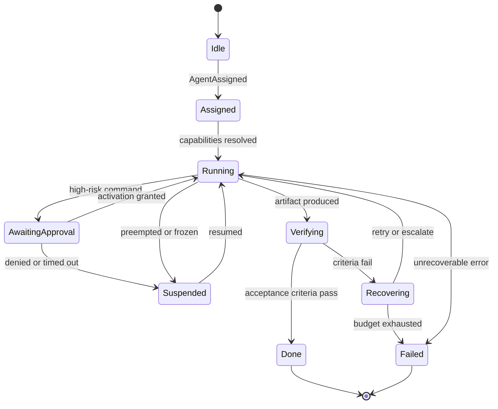

Inside `Running`, a shadow agent may plan, act and reflect in any order. A team that wants such a procedure can ship it as a nested chart in the cognitive plane, with eval evidence.

```text
state machine -> decides what the agent may do now
model router  -> decides which compute resource to use
model         -> performs probabilistic computation
```

The model is never the scheduler.

### 11.2 Scheduler and resource policy

The scheduler is the runtime's event loop and resource manager and the reconciler of 7.4. It reacts to events, determines runnable work from the IOM graph, allocates workers and models, enforces budgets, manages concurrency, handles retries and escalation, schedules verification and terminates completed workers. Managed resources: CPU, GPU, model capacity, network, tool concurrency, context, token, cost and latency budgets, permissions, worker count.

```ts
interface ResourcePolicy {
  maxLatencyMs?: number;
  maxCost?: number;
  maxTokens?: number;
  maxParallelWorkers?: number;
  privacy: 'local_only' | 'trusted_cloud' | 'any';
  verification: 'none' | 'optional' | 'required';
  priority: 'user-blocking' | 'user-visible' | 'background';
}
```

In practice these values are computed constraints (Chapter 8). The priority classes are those of the Prioritized Task Scheduling API. Its two companions matter as much: long steps must **yield** so pending user input is noticed, and every task carries an **abort signal**. Idle time is for consolidation and re-verifying stale evidence.

Unlike a browser event loop, this scheduler must sometimes _reason_ about allocation. That reasoning goes to decision models (11.5) held to the discipline of a worklet: no capabilities, a hard time budget, a pure function of inputs.

### 11.3 Capability resolution as hierarchical dependency injection

_Maturity M2 · research potential medium._

"Agents request capabilities, not implementations" is dependency injection, and Angular's injector model is unusually complete.

**Angular's DI, reduced to its parts.** Injectors form a tree: platform → root → environment injectors for lazily loaded routes → element injectors on components and directives. A dependency resolves by walking up from the requester; the nearest provider wins. Providers come as `useClass`, `useValue`, `useFactory` with `deps`, and `useExisting`. Non-class dependencies use `InjectionToken`s. `multi: true` collects every provider for a token into an array, which is how interceptor chains are assembled. Resolution modifiers (`optional`, `self`, `skipSelf`, `host`) control absence and which part of the tree may answer. Lifecycle hooks are called by the framework. `TestBed` swaps providers for tests.

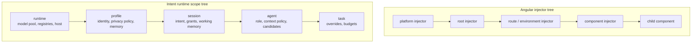

| Angular DI                       | Capability resolution                                                             |
| -------------------------------- | --------------------------------------------------------------------------------- |
| `InjectionToken<T>`              | Capability identifier (`filesystem.read`, `model.coding`); never a concrete class |
| Constructor / `inject()`         | The agent's declared `CapabilityRequirement[]`; the runtime supplies              |
| `useClass`                       | Bind a capability to a local implementation (sandbox executor)                    |
| `useValue`                       | Bind to a fixed resource (a pinned model for reproducible evals)                  |
| `useFactory` + `deps`            | **The model router is a factory provider**                                        |
| `useExisting`                    | Alias `browser.search` to `web.search`                                            |
| `multi: true`                    | Aggregate context providers; aggregate policy interceptors                        |
| Interceptor chain                | Command middleware: authorisation → redaction → budget → audit                    |
| `optional`                       | Optional capability; degrade gracefully                                           |
| `self` / `skipSelf`              | "Session memory only" versus "skip to profile memory"                             |
| `viewProviders`                  | Providers visible to an agent's own internals but not to content slotted into it  |
| Lazy route with its own injector | Skill loaded on demand with scoped providers                                      |
| Tree-shakable providers          | Only requested capabilities are bundled                                           |
| Lifecycle hooks                  | Lifecycle callbacks invoked by the scheduler                                      |
| `TestBed.overrideProvider`       | Eval harness: recorded model, fixture tools                                       |
| Import maps with `scopes`        | The platform's own declarative, scoped resolution table                           |

```ts
export const CODING_MODEL = new InjectionToken<Model>('capability:model.coding');
export const CONTEXT_PROVIDERS = new InjectionToken<ContextProvider[]>('context.providers');
export const COMMAND_PIPELINE = new InjectionToken<CommandInterceptor[]>('command.pipeline');

providers: [
  {
    provide: CODING_MODEL,
    useFactory: (r: ModelRouter, p: ResourcePolicy) =>
      r.select({ capability: 'coding', minContext: 32000 }, p),
    deps: [ModelRouter, ResourcePolicy],
  },
  { provide: CONTEXT_PROVIDERS, useClass: RepositoryContextProvider, multi: true },
  { provide: CONTEXT_PROVIDERS, useClass: GitContextProvider, multi: true },
  { provide: COMMAND_PIPELINE, useClass: AuthorizationInterceptor, multi: true },
  { provide: COMMAND_PIPELINE, useClass: BudgetInterceptor, multi: true },
  { provide: COMMAND_PIPELINE, useClass: AuditInterceptor, multi: true },
];
```

**Where DI must be tightened.** In Angular a child injector may override a parent's provider arbitrarily. Here overrides must be _attenuating_: a session may narrow the profile's permissions, never widen them; a task may restrict the model candidate set, never add a cloud model to a `local_only` session. This is capability-based security grafted onto DI.

**Negotiation on top of resolution.** Resolution answers "which implementation satisfies this token?" Negotiation adds "which is best under this policy?", scoring candidates on quality, coding, vision, tool use, context length, latency, cost and locality.

```ts
interface CapabilityRequirement {
  capability: string;
  constraints?: Record<string, unknown>;
  preferredLocality?: 'local' | 'cloud' | 'any';
  maxLatencyMs?: number;
  maxCost?: number;
}
```

### 11.4 Routing and execution modes

A route configuration declares _guards_, _resolvers_ and _lazy loading_. Task routing has the same hooks, expressed declaratively: policy guards (does this task need approval before any worker starts?), context resolvers (construct this context before the agent activates) and lazy skill activation.

Angular's route-level render modes add a fourth: each route declares `Prerender`, `Server` or `Client`. A subgoal type declares its **execution mode**: `Prerendered` (9.12), `Cloud` or `Local` (13.1), guarded by the privacy constraint.

### 11.5 Model routing, progressive escalation, decision models

_Maturity M3 · research potential medium._

The model router is subordinate to the scheduler. External routing services are one backend among several.

```text
trivial task          -> small local model
coding                -> coding specialist
complex reasoning     -> large local or cloud model
critical verification -> high-quality independent verifier
privacy = local_only  -> local candidate set only
```

**Progressive enhancement becomes progressive compute escalation.** Start with the cheapest sufficient resource and escalate on insufficiency. This yields graceful degradation and privacy by default. That leaves "sufficient?" to be defined. A weak model is the worst judge of its own sufficiency, so the acceptance criteria and a verifier answer the question.

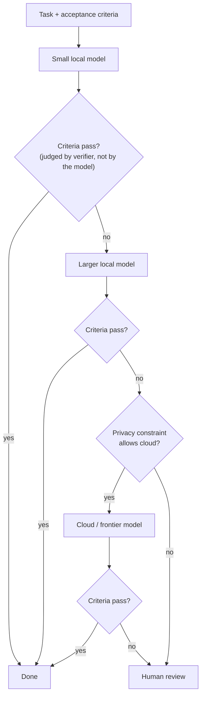

Failed cheap attempts cost time, so the router may hedge: start two tiers in parallel and cancel the loser through its abort signal.

**Decision models.** Many scheduler decisions are small classification problems: is this task simple, should I retry, should I escalate. A low-cost decision model is a plausible fit, under the worklet discipline. The source discussion named a candidate; its suitability is unverified.

### 11.6 Verification as a first-class capability

_Maturity M2 · research potential high._

Generation and verification are separated: builder → artifact → verifier → evidence → decision. Verification may be tests, static analysis, an independent model, browser execution, source comparison, schema validation, policy checks or human approval.

Separation is not independence. A verifier of the same model family reading the same context makes correlated errors. The runtime therefore records an **independence** field, and constraints can demand a minimum: the verifier must differ from the builder in at least one of method (tests beat models), model family or context. Where no independent check exists the result is `inferred`, not `verified`.

### 11.7 Reactivity and change detection

Angular's journey from zone-based change detection to signals is the harness story in miniature. Zone.js patched every asynchronous API and re-checked everything after anything happened. Many harnesses re-read everything after every tool call.

| Angular                            | Runtime                                                                         |
| ---------------------------------- | ------------------------------------------------------------------------------- |
| `signal` / `computed`              | IOM slices and derived context; decisions over evidence (7.8)                   |
| `effect`                           | Agent subscriptions: a verifier wakes on `ArtifactCreated` for its subgoal only |
| Glitch-free propagation            | Consistent snapshot per tick (7.7)                                              |
| `OnPush`                           | Agents are inspected only when their inputs change or they signal               |
| Dev-mode second check              | Double invocation of proposal steps in dev (9.9)                                |
| Render phases for reads and writes | Batched IOM operations (7.9)                                                    |

### 11.8 Failure containment and placeholders

A failed worker is contained to its subgoal: the IOM records `AgentFailed` and `SubgoalBlocked`, and the scheduler decides on retry, escalation or fallback without the intent collapsing. Angular's deferrable views give the vocabulary: a `@defer` block has a `@placeholder`, a `@loading` state and an `@error` state. A subgoal has the same three declared states. A slot's fallback content is the default that shows when no agent fills the slot. Failures are classified in the manner of HTTP status classes: the plan is wrong, the infrastructure is transient, the version is stale, the budget is exhausted. Retry policy follows the class.

### 11.9 Updating under live intents

_Maturity M1 · research potential medium to high._

What happens to a running intent when a skill, prompt or model changes? Most harnesses answer by accident. The service worker answers by design.

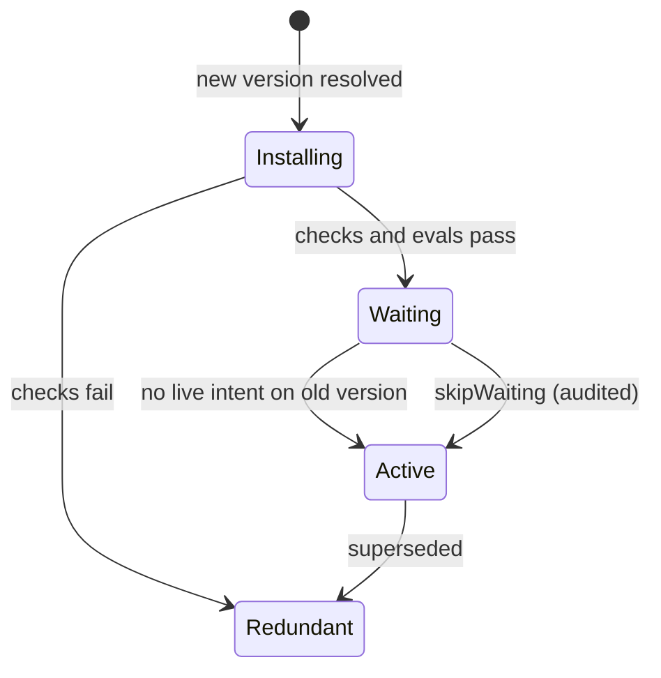

Running intents finish on the versions their lockfile snapshot names. New intents get the new version. Forcing activation is an explicit, recorded act. State-preserving swaps during development follow the hot-module-replacement rule: if a capability's contract is unchanged, keep the agent's state; if it changed, reset and replay.

### 11.10 Suspend and resume

_Maturity M2 · research potential medium._

Tabs under pressure follow the Page Lifecycle: active, hidden, frozen, discarded. A frozen intent makes no model calls. A discarded intent keeps only its event log. An intent with side effects in flight cannot be frozen, as a page with open connections is ineligible for the back/forward cache. Abandoning an intent with uncommitted side effects asks first.

Resuming is hydration from the event store. Stopping there would mean replaying everything. Angular's incremental hydration is the better model: state arrives serialised, and a part is hydrated only when a trigger fires. For an intent: load the latest snapshot, wake only the agent whose event arrives, leave completed subgoals as inert content. Two details transfer. **Event replay:** user input that arrives before the runtime is ready is captured and replayed. **Mismatch detection:** if the projection rebuilt from events disagrees with the stored snapshot, that is an error to surface.

---

## 12. Security: Origins, Not Just Permissions

### 12.1 Capability security

Capabilities are explicitly declared, granted by policy, scoped, revocable, auditable, risk-tiered and intent-aware:

```text
filesystem.read      -> automatic
filesystem.write     -> scoped
network.search       -> automatic
email.send           -> approval
purchase.execute     -> approval
financial.transfer   -> strong approval
credential access    -> isolated / restricted
```

The deterministic boundary makes enforcement possible. It is necessary and not sufficient: a model steered by injected text proposes commands that are valid, authorised and within budget, and that serve the attacker. Permissions govern what an agent may do. They say nothing about whose words it is acting on.

### 12.2 The origin model

_Maturity M1 · research potential high._

The browser's security rests on the origin. Agentic browsers have been shown to let a successful prompt injection carry data across origins and to mingle origins in memory [UW-SOP], and a benchmark with an enforcement mechanism exists [SOPGuard].

Every fragment, value and artifact carries an `Origin`. Origins fall into two channels.

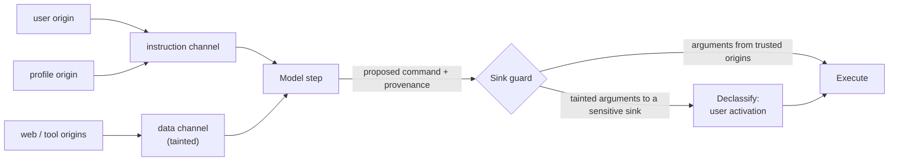

A model does not reliably respect a channel boundary drawn in its prompt. So the boundary is enforced after the model, on what it proposes.

### 12.3 CORS for context

_Maturity M1 · research potential high._

CORS lets the _resource owner_ declare who may read a response; the browser enforces it and the page's script has no say. The counterpart, **cross-origin context sharing**, lets the source of data declare which intents and destinations may consume it. The runtime enforces it and the model has no say.

| CORS                               | Context counterpart                                                                                           |
| ---------------------------------- | ------------------------------------------------------------------------------------------------------------- |
| `Access-Control-Allow-Origin`      | Which intent classes may read this data into context                                                          |
| Simple versus preflighted requests | Safe, read-only capabilities versus side-effecting ones                                                       |
| Preflight                          | A dry run: the runtime asks the target what the call would do and whether agent-originated calls are accepted |
| `Access-Control-Allow-Credentials` | Whether the user's ambient credentials may accompany the call                                                 |
| `Access-Control-Max-Age`           | How long a preflight answer may be cached                                                                     |
| Opaque responses                   | Data that may be carried but not read (12.6)                                                                  |

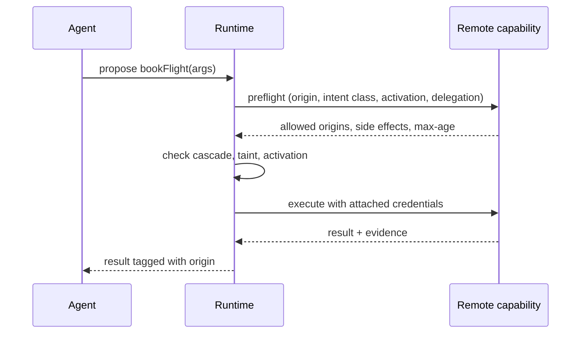

WebMCP's origin-gated tool exposure is a first step in this direction [WebMCP].

### 12.4 CSP for intents

_Maturity M1 · research potential medium to high._

A Content Security Policy is a declared allow-list the browser enforces. An intent gets one, compiled from its constraints: which origins may contribute _instructions_, which destinations data may flow to (the egress allow-list, the counterpart of `connect-src`), which skills may load. A new policy runs in **report-only** mode first: violations are recorded as `PolicyViolationReported` without blocking.

### 12.5 Trusted Types for sinks

_Maturity M1 · research potential high._

Trusted Types end DOM injection by a simple rule: dangerous sinks refuse plain strings and accept only values produced by a named policy. Agent harnesses have their own sinks: a recipient address, a URL to fetch, a shell command, a payment amount, a file path. The rule transfers.

> A sensitive sink accepts only a value whose provenance traces to a trusted origin, or which passed a declared sanitiser policy. It never accepts a raw model-generated string derived from tainted context.

The provenance graph of 7.8 already holds the needed information. CaMeL enforces a similar property by tracking capabilities on values in a custom interpreter [CaMeL]; Trusted Types give the same idea a form frontend engineers already use.

### 12.6 Tainted context and opaque handles

_Maturity M1–M2 · research potential high._

Draw a cross-origin image on a canvas without permission and the canvas is tainted: you can show it and cannot read the pixels back. The same holds for model steps. A step that has read untrusted content is tainted with that origin, and so is everything it produces. Tainted output may be displayed and stored; it may not drive a sensitive sink without declassification.

Where possible the untrusted content never enters the privileged step. The agent passes a **handle**, as an opaque response is cached without being read. This is the dual-LLM pattern in platform vocabulary.

One caveat comes from React's experimental taint API: it protects the marked object, not values derived from it [Taint]. A summary of a confidential document is still confidential. Taint must therefore propagate through every processor.

### 12.7 Credentials

_Maturity M2–M3 · research potential low to medium._

An `HttpOnly` cookie is attached by the browser and unreadable by script. Credentials are attached by the runtime at the capability boundary and never appear in model context. `SameSite` is the second half: a credential is attached only when the command's causal chain starts in the same intent. Prompt injection in an agentic browser is cross-site request forgery with a more capable deputy.

### 12.8 User activation

_Maturity M0–M1 · research potential high._

Browsers do not ask permission before a popup opens. They require that the call descends from a recent, real user gesture; the activation expires and some APIs consume it [UserAct]. This is why popup blockers work without dialogs.

The event store records causation for every command. So:

- A high-risk capability requires a user-originated event within a bounded number of causal hops and a bounded time.
- Using it consumes the activation.
- A background agent reacting to a web page has none, however valid its command looks.
- Confirming the intent diff (7.3) grants activation scoped to that spec.

This answers approval fatigue without adding prompts. The closest existing work is out-of-band approval [StepUp] and AP2's signed mandates [AP2], which are a cryptographic activation for one domain.

### 12.9 Partitioning

_Maturity M0–M1 · research potential high._

A skill installed at profile level that observes every intent is a cross-site tracker. Browsers ended this for embedded content by partitioning storage by top-level site. Skill memory is partitioned by intent unless the user grants a wider scope. A skill that wants cross-intent memory must ask, visibly.

### 12.10 Sandboxed third-party agents

_Maturity M2–M3 · research potential medium._

Third-party agents are embedded as an `<iframe>` is: default-deny, with explicit `sandbox` tokens, delegated permissions in the manner of Permissions Policy, and communication only through origin-checked messages. MCP Apps already render server-provided UI this way [AgentUI]. The stronger precondition is cross-origin isolation: the platform withholds its most powerful features from pages that have not proven isolation. An intent that has loaded no untrusted content may hold capabilities one that has loaded such content loses.

### 12.11 The local/cloud boundary

_Maturity M1–M2 · research potential high._

Angular separates server from browser by provider configuration: some providers exist only in the server configuration, and browser-only code runs in hooks that never execute on the server. The boundary is structural. The runtime treats local and cloud the same way: a provider registered only in the local scope cannot be injected into a cloud step, the build checks that no `local-only` fragment can reach one, and taint is the second line. `privacy: local-only` moves from a run-time policy to a build error.

---

## 13. Composition at Scale: SSR, Federation, Micro Frontends

### 13.1 Server-side rendering of intents

_Maturity M1 · research potential high._

SSR exists because the server can do expensive work early and ship something useful before the client has loaded anything. The same asymmetry holds between a cloud runtime with frontier models and a local runtime with small ones.

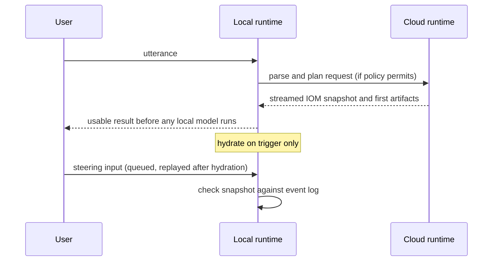

| SSR concept               | Intent counterpart                                                           |
| ------------------------- | ---------------------------------------------------------------------------- |
| Server render             | The cloud parses, cascades, plans and produces first artifacts               |
| Streaming                 | The IOM arrives incrementally; the view renders placeholders                 |
| Serialised state transfer | The snapshot ships with the result, so the local runtime re-derives nothing  |
| Incremental hydration     | Local agents attach only where interaction happens                           |
| Event replay              | Early user input is captured and replayed                                    |
| Hydration mismatch        | Local re-derivation disagrees with the shipped snapshot: an error to surface |
| Render mode per route     | Execution mode per subgoal type (11.4)                                       |
| Static generation         | Prerendered intents (9.12)                                                   |

The privacy constraint decides which subgoals may be server-rendered at all.

### 13.2 Module federation and federated skills

_Maturity M1–M2 · research potential high._

Module federation lets independently deployed applications share modules at run time. Its hard-won lesson is _shared dependency negotiation_: a host and its remotes must agree on one copy of a singleton, or dependency injection breaks. Native Federation reaches the same goal with import maps and ES modules.

| Federation concept                     | Runtime counterpart                                                                       |
| -------------------------------------- | ----------------------------------------------------------------------------------------- |
| Host and remotes                       | Intent workspace and independently deployed agent or skill providers                      |
| Remote entry manifest                  | A2A agent card; skill manifest                                                            |
| Shared singletons with strict versions | One model pool, one memory, one policy engine, one IOM schema version, negotiated at load |
| Two copies of a singleton              | Two fragment-schema versions, or two verifiers where independence accounting assumes one  |
| Import maps with scopes and integrity  | Capability alias tables per scope, with hashes from the lockfile                          |
| Scoped custom-element registries       | Scoped skill registries, so two vendors can define the same name                          |

A2A standardises how a remote agent is discovered and called [A2A]. It does not negotiate shared dependencies, because it treats remote agents as opaque.

### 13.3 Micro frontends and micro-agents

_Maturity M2 · research potential medium._

Micro-frontend architectures compose independently owned fragments into one shell. The intent workspace is the shell.

| Composition style        | Micro frontends         | Micro-agents                                 |
| ------------------------ | ----------------------- | -------------------------------------------- |
| Build time               | Packages in one build   | Installed skills, one lockfile               |
| Server side              | Edge or server includes | A gateway stitches remote agents and context |
| Run time, soft isolation | Web components          | Shadow agents (7.10)                         |
| Run time, hard isolation | Iframes                 | Sandboxed third-party agents (12.10)         |

The known failures transfer. A shared global store between micro frontends becomes shared mutable memory between agents: forbidden, with the IOM and explicit events as the only shared surface. Duplicated dependencies are 13.2. Inconsistent experience is answered by the design system (9.10). Web components earned their place as the contract between teams because they are a standard and no framework owns them: attributes in, events out, slots and parts. The shadow-agent contract is deliberately the same shape.

---

## 14. Observability and Debuggability

### 14.1 Intelligence DevTools

_Maturity M2 · research potential medium._

| Panel                     | Shows                                                                                                        |
| ------------------------- | ------------------------------------------------------------------------------------------------------------ |
| Intent Graph              | Spec and status, dependencies, blockers; assumptions highlighted                                             |
| Event Timeline            | Ordered events with causality; scrubbing reconstructs the IOM                                                |
| Agent Graph               | Live agents, states, workers, escalations; shadow roots where `open`                                         |
| Context Inspector         | Exactly what a model received, by chunk, with included and excluded fragments and the resolved configuration |
| **Constraint Inspector**  | The computed constraint per node with the winning declaration and the overridden ones struck through         |
| **Coverage**              | Fragments and tokens that never influenced an outcome                                                        |
| Model Inspector           | Selected model, reason, latency, tokens, cost, cache hit rate, retries                                       |
| Memory Inspector          | Contents, tier and partition of each memory layer                                                            |
| Capability Inspector      | Granted, requested and denied capabilities                                                                   |
| **Security**              | Origins and taint per step, activations granted and consumed, report-only violations                         |
| Decision Inspector        | Proposals, evidence, rationale, invalidations                                                                |
| Resource / Cost Inspector | Budgets consumed per intent, agent, model                                                                    |

DevTools features worth copying: breakpoints on events, conditional breakpoints, break on subtree modification for an IOM node, and local overrides for a tool result or fragment.

### 14.2 A timeline

```text
10:31 IntentParsed          10:34 TestExecuted
10:31 SpecConfirmed         10:35 TestFailed
10:32 SubgoalCreated        10:35 VerificationRequested
10:32 AgentAssigned         10:36 ContextExpanded
10:33 ContextBuilt          10:36 ModelEscalated
10:33 ModelInvoked          10:37 VerificationPassed
10:34 ArtifactCreated       10:37 GoalCompleted
```

Every line is a replayable point. Clicking `ModelEscalated` shows which criterion failed, on which evidence, under which budget.

### 14.3 AI Vitals

_Maturity M2 for operator metrics; M0–M1 for user-centric ones · research potential high._

Web Vitals worked because they measure what the user feels.

```text
Operator metrics:  task success rate · context size · inference latency · tool latency · model cost
                   retry rate · escalation rate · verification rate · correction rate
                   human intervention rate · energy consumption · cache hit rate
```

| Web Vital       | AI Vital                      | Measures                                                    |
| --------------- | ----------------------------- | ----------------------------------------------------------- |
| LCP             | Time to first useful artifact | When the user first has something of value                  |
| INP             | **Steer latency**             | Time from a user interjection to a visible change of course |
| CLS             | **Plan stability**            | How much the visible plan shifts without user input         |
| CLS, second use | **Context layout shift**      | Share of the prompt prefix that changed between calls       |
| (none)          | **Intent correction rate**    | How often the user edits the spec after confirming it       |

Evals are lab data and production traces are field data. The web learned that they disagree and that the field is the truth.

### 14.4 A protocol, not only a tool

Chrome DevTools is a client of a protocol, and the protocol created an ecosystem. Intelligence DevTools should be the first client of an inspection protocol over the IOM and event store, aligned where possible with existing trace conventions and with the typed event streams already standardised for agent frontends [AgentUI].

---

# Part VI: Evaluation

## 15. Prototype Strategy

### 15.1 Browser core selection

| Core                    | Conceptual fit | Role                      |
| ----------------------- | -------------- | ------------------------- |
| Chromium + CEF          | Very high      | Preferred prototype base  |
| WebKit                  | High           | Architectural alternative |
| Gecko / Firefox         | High           | Research alternative      |
| Raw V8 / JavaScriptCore | Low            | An engine, not a platform |

The governing rule: do not fork a browser first, and do not put runtime logic into Chromium's C++ internals. Build the intelligence runtime as a separate host subsystem in TypeScript, integrate through explicit APIs and IPC, and only later, if proven, promote intelligence to a first-class browser process.

### 15.2 Host architecture

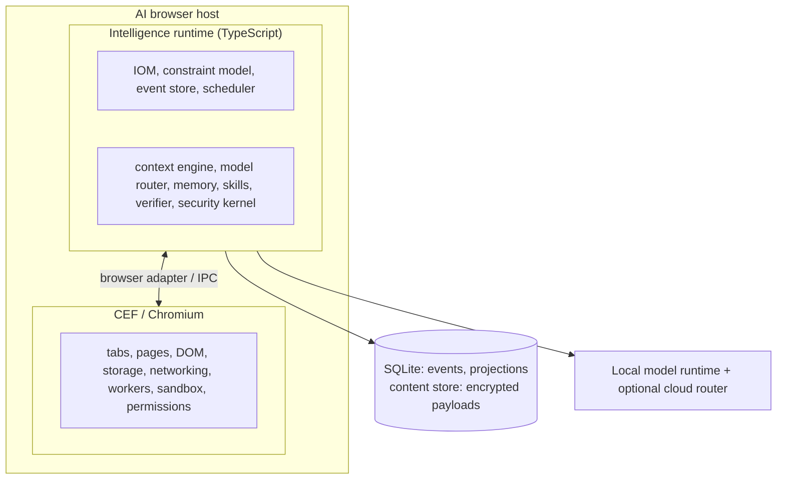

### 15.3 Phases

0. **Baseline.** A plain single-loop agent on real tasks, instrumented. Every later phase must beat it on a stated metric.
1. **IOM and runtime.** Parser with intent diff, spec/status, events, versions, scheduler. No browser. Proves the abstraction.
2. **Constraint model and security kernel.** Cascade, origins, taint, sink guards, activation.
3. **Context engine and build pipeline.** Providers, declarative configuration, chunks, budgets, lint, lockfile.
4. **Model router.** Local small, local large, cloud; conformance probes; escalation judged by criteria.
5. **Browser integration.** CEF: tabs, navigation, read, search, forms, downloads, authentication.
6. **Semantic capability layer.** `SearchWeb`, `ReadPage`, `FillForm`, `SubmitForm`, `Schedule`, `Purchase`; WebMCP where offered.
7. **Intelligence DevTools.**

Security comes as early as phase 2 because an object model that scripts can drive is an attack surface from its first day (5.1).

### 15.4 Runtime shape

```ts
interface IntelligenceRuntime {
  parser: IntentParser;
  intents: IntentStore;
  constraints: ConstraintEngine;
  events: EventStore;
  context: ContextEngine;
  scheduler: Scheduler;
  agents: AgentRegistry;
  models: ModelRouter;
  capabilities: CapabilityRegistry;
  memory: MemoryStore;
  verifier: VerificationEngine;
  security: SecurityKernel;
}

interface Agent {
  id: string;
  capabilities: CapabilityRequirement[];
  state: AgentState;
  execute(task: AgentTask, signal: AbortSignal): Promise<AgentResult>;
}
interface Model {
  id: string;
  capabilities: ModelCapabilities;
  invoke(request: ModelRequest): Promise<ModelResult>;
}
interface ModelRouter {
  select(req: ModelRequirements, policy: ResourcePolicy): Promise<Model>;
}
interface Capability {
  id: string;
  description: string;
  inputSchema: unknown;
  outputSchema: unknown;
  permissions: Permission[];
  risk: RiskLevel;
  safe: boolean;
  idempotent: boolean;
  sinks?: SinkPolicy[];
  preflight?(input: unknown): Promise<PreflightResult>;
  execute(input: unknown): Promise<unknown>;
}
```

### 15.5 Declarative agent manifest

```yaml
agent:
  name: coding-agent
  version: 2.0.0
  mode: shadow # light | shadow (7.10)
  inspect: open

dependencies: # resolved from a skill registry, pinned by lockfile
  '@skill/filesystem': ^2.1.0
  '@skill/git': ^3.0.0
  '@skill/test-runner': ~1.2.0
  '@context/repository': ^1.0.0
  '@context-config/coding': ^0.9.0

peerModelCapabilities: # supplied by the host's model pool
  toolUse: required
  structuredOutput: required
  minContextTokens: 32000
  conformance: '@conformance/coding@^1' # a behavioural suite, not a model name

context: ./context.config.js
constraints: ./agent.constraints
machine: ./agent.machine.ts
prompts: ./prompts/

models:
  candidates:
    - { id: local-coder-small, class: vendored }
    - { id: local-coder-large, class: vendored }
    - { id: cloud-coder, class: pinned-snapshot }
```

Privacy, cost and verification are not kept in a separate `policy` block; they are constraint declarations (8.2).

### 15.6 Twelve-factor mapping (operations layer)

| Factor                | Runtime interpretation                                                     |
| --------------------- | -------------------------------------------------------------------------- |
| Codebase              | Agent and runtime definition                                               |
| Dependencies          | Models, skills, tools, context providers (declared, pinned)                |
| Config                | Routing, context, constraints, budgets                                     |
| Backing services      | Event store, vector store, model server, browser, filesystem, cloud models |
| Build / release / run | Package and evaluate → release → execute                                   |
| Processes             | Disposable inference and agent workers with external durable state         |
| Port binding          | Capability interfaces                                                      |
| Concurrency           | Parallel agents, model and tool calls                                      |
| Disposability         | Disposable worker and model instances                                      |
| Dev/prod parity       | Same runtime, model and context contracts across environments              |
| Logs                  | Agent, model, tool and context events                                      |
| Admin processes       | Reindex, replay, rebuild projections, evaluate models, audit drift         |

Loaded models and KV caches hold substantial run-time state, so "stateless process" must be read as "durable semantic state is external". Twelve-factor governs deployment; the rest of this thesis governs behaviour. 12-Factor Agents [12FA] applies the same spirit to agent code.

---

## 16. Maturity and Research Register

### 16.1 The gap in one sentence

The AI ecosystem has run-time behaviour without build-time discipline, and permissions without origins. The frontend ecosystem acquired both in response to scale and breakage.

### 16.2 Register

Phase: **B** build time, **R** run time. Maturity rates the AI counterpart (2.5).

| #   | Concept                                   | Web / frontend source               | Phase | Maturity | Closest existing work                  | Research potential |
| --- | ----------------------------------------- | ----------------------------------- | ----- | -------- | -------------------------------------- | ------------------ |
| 1   | Model as compute resource                 | V8                                  | R     | M4       | Inference engines                      | Low                |
| 2   | Intelligence runtime as a whole           | Browser                             | R     | M2       | Harness SDKs, agentic browsers         | High               |
| 3   | IOM with spec/status                      | DOM, Kubernetes                     | R     | M1       | IAL, checkpoints                       | High               |
| 4   | Specified intent parsing, intent diff     | HTML parser                         | B/R   | M1       | AP2 mandates, spec-driven tooling      | High               |
| 5   | Acceptance criteria as nodes              | n/a                                 | R     | M1–M2    | Test-driven agent loops                | Medium             |
| 6   | Constraint cascade                        | CSS cascade                         | B/R   | M1       | Instruction hierarchy, prompt layering | High               |
| 7   | Typed, registered constraints             | CSS Typed OM, `@property`           | B     | M2       | Policy-as-code, structured outputs     | Medium             |
| 8   | Derivation pipeline, invalidation classes | Rendering pipeline                  | R     | M0–M1    | Incremental build systems              | High               |
| 9   | Event-sourced state, time travel          | Event sourcing                      | R     | M2–M3    | Checkpointing, durable execution       | Medium             |
| 10  | Versions, transactions, locks, forks      | ETag, IndexedDB, Web Locks          | R     | M1       | Worktrees for coding agents            | High               |
| 11  | Typed epistemic status and retraction     | Signals                             | R     | M1       | Truth maintenance, citations           | High               |
| 12  | Shadow agents                             | Shadow DOM                          | R     | M2       | Sub-agents with isolated context       | Medium             |
| 13  | Oversight tree                            | Accessibility tree, AOM             | R     | M1       | AG-UI events, traces                   | High               |
| 14  | Capability tree for the web               | ARIA                                | R     | M2       | WebMCP, MCP, NLWeb                     | Medium             |
| 15  | Community capability declarations         | DefinitelyTyped                     | B     | M0–M1    | n/a                                    | Medium             |
| 16  | Declarative context composition           | ESLint flat config                  | B     | M2       | AGENTS.md, skills, Priompt             | Medium–High        |
| 17  | Harness and constraint linter             | ESLint                              | B     | M1–M2    | Skill scanners                         | Medium             |
| 18  | AOT-compiled context plans                | Angular AOT                         | B     | M1       | DSPy, BAML                             | Medium–High        |
| 19  | Conformance suites and probing            | WPT, test262, feature detection     | B     | M1–M2    | Benchmarks                             | High               |
| 20  | Capability shims                          | Polyfills                           | B/R   | M2       | Provider abstraction layers            | Medium             |
| 21  | Cache-aware context chunks                | Chunk splitting, content hashes     | B     | M2       | Manual practice, cache breakpoints     | Medium             |
| 22  | Critical-context extraction               | Critical CSS inlining               | B     | M1–M2    | Progressive disclosure in skills       | High               |
| 23  | Context budgets in CI                     | Bundle budgets                      | B     | M2       | Token counting                         | Low–Medium         |
| 24  | Skill registry and lockfile               | npm                                 | B     | M2       | ToolHive, APM, Quiver, MCP Registry    | Medium             |
| 25  | Model dependency classes, fingerprints    | `peerDependencies`, audit           | B     | M1       | Model cards, evals                     | High               |
| 26  | Evals as tests, three replay modes        | Record and replay                   | B     | M2–M3    | Eval platforms                         | Medium             |
| 27  | Context coverage, mutation testing        | Coverage panel, mutation testing    | B     | M1       | Ablation practice                      | High               |
| 28  | Metamorphic parser tests, pseudo-model    | Property tests, pseudo-localisation | B     | M1       | n/a                                    | Medium–High        |
| 29  | Migrations for model upgrades             | `ng update`                         | B     | M1       | Prompt optimisers                      | Medium–High        |
| 30  | Prerendered intents                       | Static generation                   | B     | M1       | Workflow templates                     | Medium             |
| 31  | Memory topology                           | Browser storage tiers               | R     | M2–M3    | Memory frameworks                      | Medium             |
| 32  | Erasure by crypto-shredding               | n/a                                 | R     | M2       | Event-sourcing practice                | Medium             |
| 33  | Hierarchical DI with attenuation          | Angular DI                          | R     | M2       | Permission modes                       | Medium             |
| 34  | Control-plane statechart                  | XState, SCXML                       | R     | M3       | Graph frameworks                       | Low–Medium         |
| 35  | Priorities, yielding, abort               | Task scheduling, `AbortSignal`      | R     | M2       | Interrupt and steer features           | Medium             |
| 36  | Routing and escalation by criteria        | Progressive enhancement             | R     | M3       | Model routers                          | Medium             |
| 37  | Verification independence                 | n/a                                 | R     | M2       | Model-as-judge, tests                  | High               |
| 38  | Update lifecycle under live intents       | Service-worker lifecycle            | R     | M1       | Ad hoc pinning                         | Medium–High        |
| 39  | Incremental resume, event replay          | Incremental hydration               | R     | M2       | Checkpoint resume                      | Medium             |
| 40  | Origin model for context                  | Same-origin policy                  | R     | M1       | SOPGuard                               | High               |
| 41  | CORS for context, preflight               | CORS                                | R     | M1       | WebMCP origin gating                   | High               |
| 42  | CSP for intents, report-only              | CSP                                 | B/R   | M1       | Allow-lists                            | Medium–High        |
| 43  | Trusted Types for sinks                   | Trusted Types                       | R     | M1       | CaMeL                                  | High               |
| 44  | Taint and opaque handles                  | Tainted canvas, opaque responses    | R     | M1–M2    | Dual LLM, CaMeL, FIDES                 | High               |
| 45  | User activation by causality              | User activation                     | R     | M0–M1    | Step-up approval, AP2                  | High               |
| 46  | Memory partitioning                       | Storage partitioning                | R     | M0–M1    | n/a                                    | High               |
| 47  | Server-rendered intents; federated skills | SSR; module federation              | B/R   | M1–M2    | Cloud agents; A2A, Agent Plugins       | High               |
| 48  | User-centric AI Vitals                    | Core Web Vitals                     | R     | M0–M1    | Observability platforms                | High               |

### 16.3 Reading the register

Three patterns stand out. The highest research potential clusters where the web has a _security_ mechanism (rows 40 to 46) and where it has a _derivation_ mechanism (rows 4, 6, 8, 22). Packaging and orchestration (rows 24, 34, 36) are mostly consolidation work. And every M0–M1 row with high potential is something a frontend engineer already understands better than most AI engineers, which is the practical argument of this thesis.

---

## 17. Discussion

### 17.1 Where the analogy fails

Three things have no web precedent. _Probabilistic execution_: a component renders the same output for the same inputs; a model does not, so verification and retry are structural. _Epistemic state_: frontend state is true by construction; runtime knowledge is believed with evidence. _Intent as object_: no frontend abstraction represents what the user is trying to achieve. A fourth belongs with them: _the consumer can be talked into things_. A rendering engine cannot be persuaded by the document it renders. That is why Chapter 12 enforces after the model.

### 17.2 Risks and open questions

- **Over-engineering.** A full runtime is heavy for a single-agent task. Phase 0 exists so that every mechanism earns its place.
- **The IOM as bureaucracy.** Mitigated by shadow agents and invalidation classes. Whether the remaining overhead pays is empirical.
- **Intent fidelity.** The parser can be specified; meaning cannot be verified. The intent diff shifts the risk to a place where the user can see it.
- **The cascade is powerful and easy to misuse.** Specificity wars are a known pathology. Layers and a linter help.
- **Taint is conservative.** Everything touched by untrusted content loses privileges, which costs utility; CaMeL reports the same trade [CaMeL].
- **Scheduling intelligence.** A scheduler that reasons is probabilistic at the margin.
- **Standardisation.** A venue exists; adoption is not guaranteed, as Web Intents shows.
- **Counterfactual evaluation.** Trajectory replay stops at divergence. Simulated capabilities are an open problem.
- **Registry governance.** A skill registry inherits every supply-chain problem of npm, plus prompt injection.

### 17.3 Governance relevance

The properties this architecture produces as by-products are those regulated environments require: a replayable record of inputs and decisions; separation of a probabilistic proposer from a deterministic authoriser; explicit, risk-tiered, causally grounded approval; provenance and origin for every artifact; verification with recorded independence; a stable oversight projection; and erasure that leaves the audit chain intact. This is an argument for the design, not a claim of compliance.

### 17.4 Threats to validity

Analogy-driven design risks importing solutions to problems one does not have and missing problems the reference system never had. Section 17.1 names the second risk; Phase 0 and the ablation gates address the first. The declared bias of 1.4 is a threat too: a reader fluent in other frameworks may find mappings this thesis overlooked. The maturity ratings are one group's judgement. Statements about the ecosystem were checked in November 2026 against sources of mixed quality, including vendor documentation and secondary reporting, and should be re-examined before publication.

---

## 18. Conclusion

1. **Model size is not the whole intelligence problem.**
2. **Agents are not models.** Agents are runtime objects with lifecycle; models are compute.
3. **Context is constructed, not dumped**, and laid out stable-first.
4. **Memory is a topology.**
5. **Events are first-class.**
6. **Browser architecture is a valid reference**, including its parser, its cascade and its origins.
7. **Intent is a first-class runtime object**, parsed by a specified procedure and confirmed by the user.
8. **Spec belongs to the user, status to the system.**
9. **Structure, constraints and behaviour are separate languages** with separate object models.
10. **Policy is resolved by a cascade outside the model.**
11. **Security starts with origins.** Enforcement happens after the model, on what it proposes.
12. **An AI browser is not browser plus chatbot.**
13. **Control is mandatory, cognition is optional.**
14. **Frontend engineering remains relevant in both phases.** Its build-time discipline is what the AI ecosystem most lacks, and its platform knowledge is what AI security most needs.

In one sentence:

> The proposed AI browser is a browser-like intelligence runtime in which each tab represents a user intent; the intent is parsed into a confirmed specification, constrained by a cascade and reconciled by a scheduler into an event-sourced status; agents and workers collaborate through that shared object model; context is composed declaratively at build time and laid out for caching at run time; every value carries an origin and every consequential action a causal link to the user; models are interchangeable compute selected by measured capability; and the whole system is inspectable through intent-oriented DevTools.

The deepest abstraction is not the LLM, the agent, the page or the transcript. It is the intent, and the runtime that holds it.

---

## Appendix A. Glossary

| Term                            | Meaning                                                                                               |
| ------------------------------- | ----------------------------------------------------------------------------------------------------- |
| Intelligence runtime            | Persistent execution environment coordinating AI computation                                          |
| AI browser                      | A browser-like runtime organised around user intent                                                   |
| IOM (Intent Object Model)       | Shared, inspectable, event-sourced object graph of an active intent                                   |
| Spec / status                   | User-owned statement of what is wanted / system-derived account of what has been done                 |
| Intent parser                   | Specified procedure turning an utterance into a confirmed spec                                        |
| Intent diff                     | The parsed spec rendered back to the user for confirmation                                            |
| Acceptance criterion            | A checkable condition that defines when a goal is done                                                |
| Constraint model                | All constraint declarations plus the computed value per node                                          |
| Constraint sheet                | A file of constraint rules with selectors over the IOM                                                |
| Cascade                         | Deterministic resolution of competing constraints by origin, importance, layer, specificity and order |
| Oversight tree                  | Derived projection of the IOM for people, auditors and assistive technology                           |
| Capability tree                 | Semantic view of what the outside world offers to agents                                              |
| Intent workspace                | User-facing tab or session for one active intent                                                      |
| Agent                           | Stateful runtime role with lifecycle, policies and capability requirements; not a model               |
| Light / shadow agent            | Agent whose every step is an IOM command / agent that runs encapsulated behind a declared surface     |
| Worker                          | Isolated unit of concurrent execution                                                                 |
| Capability                      | Explicitly declared, schema-bound, permissioned executable function or resource                       |
| Skill                           | Versioned package bundling capabilities, providers and presets                                        |
| Capability negotiation          | Scored resolution of a requirement against candidate implementations                                  |
| Capability shim                 | Adapter that provides a stable contract over differing implementations                                |
| Context provider / engine       | Adapter supplying fragments / composer of a snapshot under a compiled plan                            |
| Context chunk                   | A volatility class of context with a cache breakpoint at its end                                      |
| Critical context                | The fragments needed for an agent's first decision                                                    |
| Harness linter                  | Static checker for agent configurations, constraints and policies                                     |
| Model router                    | Selects a compute resource under requirements and policy; a factory provider                          |
| Conformance suite               | Behavioural tests for a capability contract, run against models                                       |
| Behavioural fingerprint         | Hash of conformance results recorded in the lockfile                                                  |
| Event store                     | Durable, append-only temporal execution history                                                       |
| Epistemic status                | Whether a piece of evidence is observed, inferred, verified, stale or contradicted                    |
| Provenance graph                | Links from an artifact to its producer, model, context, evidence, origins and events                  |
| Origin                          | Identity of whoever contributed a piece of context or a value                                         |
| Taint                           | The set of untrusted origins that influenced a step or value                                          |
| Sink guard                      | Check that a sensitive argument has trusted provenance or passed a sanitiser policy                   |
| User activation                 | A causal link from a command to a recent, real user action                                            |
| Invalidation class              | The earliest derivation stage a change makes dirty                                                    |
| Control plane / cognitive plane | Mandatory authority, audit and isolation / optional thinking procedure                                |
| Scheduler                       | Reconciles status toward spec; allocates workers, models and budgets                                  |
| Intelligence DevTools           | Inspection and debugging environment over the IOM and event store                                     |
| AI Vitals                       | Runtime metrics usable as service-level objectives                                                    |
| Profile                         | Persistent personal intelligence environment shared by all sessions                                   |
| Skill registry                  | Versioned, attested package distribution for skills, providers and presets                            |

---

## References

Works are cited by key. URLs are given where the source was consulted in November 2026; classic works are cited by author and year. Several sources are vendor documentation or secondary reporting and should be verified before external publication.

- **[12FA]** HumanLayer. _12-Factor Agents._ 2025. https://github.com/humanlayer/12-factor-agents
- **[A2A]** Agent2Agent Protocol, v1.0; hosted by the Agentic AI Foundation since August 2026. https://a2a-protocol.org
- **[AAIF]** Linux Foundation. _Agentic AI Foundation Announces Four New Projects: Agent Skills, Open Responses, OpenEnv, and OpenSandbox._ 22 October 2026. https://www.linuxfoundation.org/press/agentic-ai-foundation-announces-four-new-projects-agent-skills-open-responses-openenv-and-opensandbox · Agent Skills: https://agentskills.io
- **[Absorb]** O'Reilly Radar (2026) and Latent Space (August 2026), essays on models absorbing agent harnesses. https://www.oreilly.com/radar/ · https://www.latent.space/
- **[AgentUI]** AG-UI Protocol 1.0 (September 2026), https://github.com/ag-ui-protocol/ag-ui · A2UI, _How Does A2UI Compare?_ (covers MCP Apps, SEP-1865), https://a2ui.org/introduction/agent-ui-ecosystem/
- **[Angular]** Angular roadmap and documentation: signals, incremental hydration, route-level render modes. https://angular.dev/roadmap
- **[AOM]** WICG. _Accessibility Object Model_ and implementation status. https://wicg.github.io/aom/spec · https://wicg.github.io/aom/caniuse.html
- **[AP2]** Google. _Announcing Agent Payments Protocol (AP2)._ September 2025. https://cloud.google.com/blog/products/ai-machine-learning/announcing-agents-to-payments-ap2-protocol
- **[CaMeL]** Debenedetti et al. _Defeating Prompt Injections by Design._ arXiv:2503.18813, 2025.
- **[Cascade]** MDN. _Introduction to the CSS cascade._ https://developer.mozilla.org/en-US/docs/Web/CSS/CSS_cascade/Cascade
- **[IAL]** _Towards an Intention Abstraction Layer for Autonomous Industrial Systems._ arXiv:2607.14553, 2026.
- **[Lock]** Skill packaging and supply chain: ToolHive lockfile, https://pkg.go.dev/github.com/stacklok/toolhive · APM, https://pypi.org/project/apm-cli/ · Quiver, https://pkg.go.dev/github.com/astra-sh/qvr · NVIDIA verified agent skills, https://developer.nvidia.com/blog/nvidia-verified-agent-skills-provide-capability-governance-for-ai-agents/ · Snyk, _ToxicSkills_, February 2026 (as reported).
- **[Manus]** Ji, Y. _Context Engineering for AI Agents: Lessons from Building Manus._ July 2025. https://manus.im/blog/Context-Engineering-for-AI-Agents-Lessons-from-Building-Manus
- **[ManyIH]** _Many-Tier Instruction Hierarchy in LLM Agents._ arXiv:2604.09443, 2026.
- **[MCP]** Model Context Protocol. https://modelcontextprotocol.io
- **[MemGPT]** Packer et al. _MemGPT: Towards LLMs as Operating Systems._ arXiv:2310.08560, 2023.
- **[Priompt]** Lunnemark, A. _Prompt design._ Cursor, 2023. https://cursor.com/blog/prompt-design · https://github.com/anysphere/priompt
- **[SOPGuard]** Wang, Chen, Li, Song, Gong. _Same-Origin Policy for Agentic Browsers._ arXiv:2606.14027, 2026.
- **[StepUp]** WorkOS. _Step-up authentication for AI agents._ 2026. https://workos.com/blog/step-up-authentication-ai-agents
- **[Taint]** React documentation. _experimental_taintObjectReference._ https://react.dev/reference/react/experimental_taintObjectReference
- **[UserAct]** MDN. _User activation._ https://developer.mozilla.org/en-US/docs/Web/Security/User_activation
- **[UW-SOP]** _Agentic Browsers and the Same-Origin Policy._ Agents in the Wild workshop, ICLR 2026. https://iclr.cc/virtual/2026/10016297
- **[WebMCP]** Chrome for Developers. _WebMCP._ https://developer.chrome.com/docs/ai/webmcp/imperative-api · browser support summary, October 2026: https://www.mcpbundles.com/guides/webmcp-browser-support

Classic works cited by name: Harel, _Statecharts_ (1987) and W3C SCXML (2015); Erman et al., _The Hearsay-II Speech-Understanding System_ (1980); Hewitt et al., the actor model (1973); Doyle, _A Truth Maintenance System_ (1979); Rao and Georgeff, BDI agents (1995); Young and Fowler on CQRS and event sourcing; Wiggins, _The Twelve-Factor App_ (2011); IETF RFC 9315, _Intent-Based Networking_ (2022); Willison, _The Dual LLM pattern_ (2023); FIDES (Microsoft Research, 2025); AIOS (2024).
